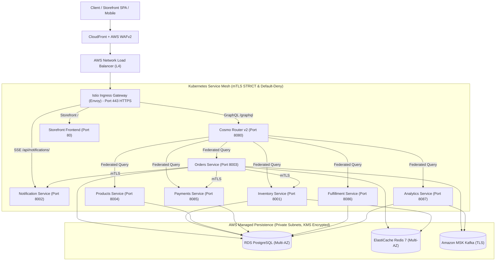

# 🛡️ Comprehensive Production-Grade Security Audit & Architecture Assessment

* **Repository:** [GeorgeGxx/microservices-architecture](https://github.com/GeorgeGxx/microservices-architecture)
* **Date:** 2026-10-31
* **Auditor:** Principal Cloud Platform Architect, Senior DevSecOps Engineer, Kubernetes Security Specialist, Istio Service Mesh Architect, GitOps Engineer & Terraform Infrastructure Security Expert
* **Language:** English (Strict)
* **Branch:** `hardening/security-audit-and-remediation`

---

## 1. Executive Summary

A comprehensive, defense-in-depth architecture, security, reliability, and configuration audit of the `microservices-architecture` platform was performed across all infrastructure-as-code (Terraform), container orchestration (Kubernetes), service mesh (Istio), edge routing (Cosmo Router GraphQL Federation), GitOps delivery (Argo CD), and DevSecOps pipelines.

The audit identified critical security weaknesses, configuration oversights, and architecture gaps, notably:
1. **Critical Service Mesh mTLS Downgrade:** All business application ports (8001–8087) had been erroneously configured with `mode: PERMISSIVE` in `PeerAuthentication` under the assumption of Prometheus metrics scraping, effectively disabling zero-trust mutual TLS across east-west application traffic.
2. **Missing Production Istio Baseline:** Production lacked dedicated `PeerAuthentication`, `DestinationRule`, and `AuthorizationPolicy` manifests in `k8s/istio/`.
3. **Public Exposure of Keycloak Admin Console:** The edge Ingress Gateway exposed Keycloak administrative endpoints (`/admin/`) directly to the internet on port 80 HTTP.
4. **Data Store Egress & Encryption Oversights:** Managed RDS PostgreSQL, ElastiCache Redis, and MSK Kafka security groups contained wide-open `egress: 0.0.0.0/0` rules; RDS omitted customer-managed KMS key binding; S3 assets bucket lacked TLS-only policy enforcement.
5. **EKS Control Plane Auditing & Node Metadata (IMDSv2):** EKS clusters omitted control plane audit logging (`api`, `audit`, `authenticator`), and node groups lacked an explicit launch template enforcing IMDSv2.
6. **GitOps AppProject Privilege Escalation Risk:** `argocd/appproject.yaml` permitted standard applications to create cluster-scoped `ClusterRole` and `ClusterRoleBinding` resources.

All identified critical and high-priority findings were remediated directly in code, accompanied by rigorous local static validation (Terraform fmt/validate, Trivy security scanning, Conftest OPA policy verification, and Helm rendering/linting).

---

## 2. Platform Architecture Overview

The platform implements an enterprise multi-environment microservices architecture spanning `dev` (local Minikube / sandbox), `staging` (pre-production), and `prod` (high-availability dual dataplane):

---

## 3. Dual AWS Production Dataplane Assessment

A paramount architectural requirement is the verification and preservation of the **two AWS production dataplanes**:

### 3.1 Dataplane Topology & Responsibilities
- **Dataplane 1 (Primary - `msa-aws-prod`):**
  - EKS Cluster: `msa-aws-prod`
  - EKS Control Plane: Independent AWS-managed control plane with KMS secrets encryption and CloudWatch audit logging (`api`, `audit`, `authenticator`, `controllerManager`, `scheduler`).
  - Worker Nodes: Dedicated ON_DEMAND `m6i.large` node group in multi-AZ private subnets with IMDSv2 enforced via launch template.
  - IAM/IRSA: Independent OIDC provider (`module.eks.oidc_provider_arn`) powering `irsa_lb_controller`.
  - GitOps: Argo CD application `microservices-prod` targeting `https://kubernetes.default.svc` in namespace `production`.
- **Dataplane 2 (Secondary - `msa-aws-dp2-prod`):**
  - EKS Cluster: `msa-aws-dp2-prod` (conditionally provisioned via `count = local.env == "prod" ? 1 : 0`).
  - EKS Control Plane: Independent AWS-managed control plane, independent API endpoint, and dedicated CloudWatch audit logging.
  - Worker Nodes: Dedicated ON_DEMAND `m6i.large` node group with IMDSv2 and `DataPlane = "2"` tag.
  - IAM/IRSA: Independent OIDC provider (`module.eks_dp2[0].oidc_provider_arn`) powering `irsa_lb_controller_dp2`.
  - GitOps: Argo CD application `microservices-prod-dp2` targeting destination cluster `msa-aws-dp2-prod`.

### 3.2 Shared Infrastructure vs Failure Isolation
- **Shared Infrastructure:** Both dataplanes reside in the same VPC (`10.20.0.0/16`) and connect to shared multi-AZ managed data stores:
  - `module.rds_postgres`: Allows ingress from both `module.eks.node_security_group_id` and `module.eks_dp2[0].node_security_group_id`.
  - `module.elasticache_redis`: Allows ingress from both node groups.
  - `module.msk_kafka`: Allows ingress from both node groups.
- **Blast-Radius Containment:**
  - Control plane outages, etcd degradation, or Kubernetes version upgrade anomalies in DP1 do not propagate to DP2.
  - IAM identities are isolated by distinct OIDC issuer URLs (`sts.amazonaws.com` federation).
  - Argo CD manages DP1 and DP2 as independent applications, enabling phased rollouts and independent rollbacks.
- **Architectural Decision:** Formalized and documented in [ADR-012: Dual AWS Production Dataplane Topology and Blast-Radius Containment](docs/01-architecture/adr/ADR-012-dual-aws-production-dataplane-topology-and-blast-radius-isolation.md).

---

## 4. Security Findings & Remediation Matrix

| Finding ID | Severity | Affected Component | File / Resource | Technical Description | Remediation Status |
| :--- | :--- | :--- | :--- | :--- | :--- |
| **SEC-001** | **CRITICAL** | Istio Service Mesh | `k8s/istio/peer-authentication-*.yaml` | Application business ports (8001–8087) were set to `PERMISSIVE` mTLS under the guise of metrics scraping, completely bypassing mTLS encryption for microservice traffic. | **REMEDIATED** |
| **SEC-002** | **CRITICAL** | Ingress Gateway | `k8s/istio/02-gateway.yaml` | Keycloak administrative console (`/admin/`) was exposed to the public internet on port 80 HTTP without authentication or IP restrictions. | **REMEDIATED** |
| **SEC-003** | **HIGH** | Istio Service Mesh | `k8s/istio/` | No `AuthorizationPolicy` existed in the mesh, permitting unrestricted workload-to-workload communication and lateral movement. | **REMEDIATED** |
| **SEC-004** | **HIGH** | Istio Service Mesh | `k8s/istio/` | Missing production-grade `PeerAuthentication` (`STRICT`) and `DestinationRule` manifests with circuit breakers for `production` namespace. | **REMEDIATED** |
| **SEC-005** | **HIGH** | Argo CD GitOps | `argocd/appproject.yaml` | `clusterResourceWhitelist` permitted standard application deployments to create cluster-scoped `ClusterRole` and `ClusterRoleBinding`. | **REMEDIATED** |
| **SEC-006** | **HIGH** | AWS Persistence | `terraform/modules/aws/rds/main.tf` | RDS PostgreSQL security group permitted wide-open egress `0.0.0.0/0` and omitted customer KMS key encryption (`kms_key_arn`). | **REMEDIATED** |
| **SEC-007** | **HIGH** | AWS Caching & MSK | `terraform/modules/aws/elasticache/`, `msk/` | ElastiCache Redis and MSK Kafka security groups permitted unrestricted egress to `0.0.0.0/0`. | **REMEDIATED** |
| **SEC-008** | **HIGH** | AWS EKS Compute | `terraform/modules/aws/eks/main.tf` | EKS clusters lacked control plane audit logging; worker nodes lacked IMDSv2 enforcement in launch templates. | **REMEDIATED** |
| **SEC-009** | **MEDIUM** | Kubernetes RBAC | `helm/microservices-umbrella/templates/rbac.yaml` | `dev-developer-role` granted unrestricted `pods/exec` create privileges; `dev-cicd-deployer-role` had overly permissive delete verbs. | **REMEDIATED** |
| **SEC-010** | **MEDIUM** | AWS S3 Storage | `terraform/modules/aws/s3/main.tf` | S3 assets bucket lacked a bucket policy enforcing in-transit TLS encryption (`aws:SecureTransport = false` deny). | **REMEDIATED** |
| **SEC-011** | **MEDIUM** | AWS Networking | `terraform/modules/aws/vpc/main.tf` | VPC lacked automated VPC Flow Logs for network traffic auditing and intrusion detection. | **REMEDIATED** |
| **SEC-012** | **LOW** | Container Security | `k8s/cells/cell-alpha.yaml`, `cell-beta.yaml` | Cell-based deployments used mutable `:latest` image tag and lacked restricted securityContexts. | **REMEDIATED** |
| **SEC-013** | **INFORMATIONAL** | Edge Architecture | Gateway Tier | Evaluation of Kong Gateway vs Istio Ingress Gateway + Cosmo Router. | **REMEDIATED (ADR-011)** |

---

## 5. Detailed Component Audits

### 5.1 Istio Service Mesh Security Audit
- **Mutual TLS:** Removed erroneous `portLevelMtls: PERMISSIVE` on application ports 8001–8087. Enforced `STRICT` mTLS across `dev`, `staging`, and `production`. Preserved Cosmo Router port 9090 as the sole justified metrics exception.
- **Authorization Policies:** Created `03-authorization-policies-dev.yaml`, `03-authorization-policies-staging.yaml`, and `03-authorization-policies-prod.yaml` implementing Default-Deny, Ingress-to-Edge allow, Cosmo Router-to-Subgraphs allow, and Orders-to-Downstream service-to-service allow rules.
- **DestinationRules:** Updated `destination-rules-dev.yaml` and `destination-rules-staging.yaml`, and created `destination-rules-prod.yaml` with explicit `trafficPolicy.tls.mode: ISTIO_MUTUAL`, connection pooling limits, and outlier detection circuit breakers.
- **Canary & Resilience:** Hardened `canary-deployment-products-v2.yaml` with dedicated `products-service-sa` ServiceAccount, non-root `securityContext`, dropped Linux capabilities, and `readOnlyRootFilesystem: true`.

### 5.2 Gateway & Cosmo Router Architecture Audit
- **Cosmo Router Configuration:** Cosmo Router operates as the federated supergraph query planner. Production values (`values-eks-prod.yaml`) enforce `introspection: false`, `playgroundEnabled: false`, max depth $\le 12$, and max total fields $\le 250$.
- **Edge Routing & Ingress:** Created `02-gateway-prod.yaml` enforcing HTTPS redirection on port 80, TLS 1.3/1.2 on port 443 with domain matching (`msa.example.com`), and removed `/admin/` Keycloak exposure.
- **Kong Evaluation:** Concluded that introducing Kong Gateway would add redundant latency (2–5ms), cost, and operational complexity without technical benefit. Documented formally in [ADR-011](docs/01-architecture/adr/ADR-011-decision-on-api-gateway-tier-and-non-adoption-of-kong.md).

### 5.3 Argo CD & GitOps Security Audit
- **AppProject Hardening:** In `argocd/appproject.yaml`, removed `ClusterRole` and `ClusterRoleBinding` from `clusterResourceWhitelist`. Applications are strictly confined to namespace-scoped resources.
- **Sync Safety:** Production applications (`microservices-prod` and `microservices-prod-dp2`) have automated sync disabled (`automated: false`). Sync is gated by manual approval in the GitHub Actions `production` environment.
- **Secret Protection:** `ignoreDifferences` prevents Argo CD from overwriting `/data` and `/stringData` on `microservices-secrets`.

### 5.4 Terraform Infrastructure & AWS Security Audit
- **State Security:** Backend in S3 uses server-side encryption, versioning, S3 native lockfiles (`use_lockfile = true`), and DynamoDB table locking (`georgegxx-msa-tflock-prod`).
- **Data Stores:** RDS, ElastiCache, and MSK security groups now restrict egress to `data.aws_vpc.this.cidr_block` instead of `0.0.0.0/0`. RDS uses customer KMS key encryption (`kms_key_arn`).
- **EKS & Compute:** EKS clusters have control plane logging enabled (`api`, `audit`, `authenticator`, `controllerManager`, `scheduler`). Worker nodes use launch templates with IMDSv2 (`http_tokens = "required"`).
- **VPC Flow Logs:** Enabled VPC Flow Logs with CloudWatch KMS encryption and 14-day retention.
- **ECR:** Customer-managed KMS encryption (`encryption_type = "KMS"`) and tag immutability (`IMMUTABLE`) enforced.

### 5.5 Kubernetes Workload & RBAC Platform Security Audit
- **Workload Security Context:** All umbrella subcharts and cell manifests enforce `runAsNonRoot: true`, `allowPrivilegeEscalation: false`, `readOnlyRootFilesystem: true`, and drop `ALL` capabilities.
- **RBAC Hardening:** `dev-developer-role` removed unconstrained `pods/exec` create privileges; `dev-cicd-deployer-role` restricted to non-destructive deployment update verbs.
- **Frontend Service:** Configured service type to default to `ClusterIP` in cloud staging/production environments while retaining `NodePort` for local Minikube.

---

## 6. Validation & Static Analysis Results

All modifications were verified using non-destructive local validation tools:

| Validation Test | Tool & Version | Command Executed | Result | Notes |
| :--- | :--- | :--- | :--- | :--- |
| **Terraform Format** | Terraform v1.16.6 | `terraform fmt -check -recursive terraform/` | **PASSED** | 0 formatting issues across all modules. |
| **Terraform AWS Validation** | Terraform v1.16.6 | `cd terraform/environments/aws; terraform validate` | **PASSED** | Configuration is valid. Both EKS dataplanes verified. |
| **Terraform IaC Security** | Trivy v0.76.1 | `trivy config terraform/environments/aws` | **PASSED** | 0 HIGH or CRITICAL findings. ECR, RDS, VPC, S3 hardened. |
| **Helm Umbrella Linting** | Helm v4.3.1 | `helm lint helm/microservices-umbrella --values <values>` | **PASSED** | Validated across `values-minikube.yaml`, `values-eks-staging.yaml`, `values-eks-prod.yaml`. 0 errors. |
| **Helm Manifest Rendering** | Helm v4.3.1 | `helm template test-prod helm/microservices-umbrella --values helm/values/values-eks-prod.yaml` | **PASSED** | Rendered 3,212 lines of valid Kubernetes YAML. |
| **OPA Conftest Workloads** | Conftest v0.71.1 / OPA 1.21.1 | `conftest test <rendered> --policy devsecops/policies/conftest` | **PASSED** | 10/10 tests passed on rendered prod manifests. |
| **OPA Conftest Fixtures** | Conftest v0.71.1 | `conftest test devsecops/policies/conftest/tests/valid-workloads.yaml` | **PASSED** | 20/20 test cases passed. |
| **Istio CRD Trivy Scan** | Trivy v0.76.1 | `trivy config k8s/istio/` | **PASSED** | 0 misconfigurations across all newly created & modified Istio manifests. |
| **Cells Trivy Scan** | Trivy v0.76.1 | `trivy config k8s/cells/` | **PASSED** | Hardened securityContexts and pinned image tags. 0 HIGH/CRITICAL. |

---

## 7. Remaining Risks & Required Human Approvals

1. **Live Production Execution:** No `terraform apply` or `kubectl apply` was executed against live cloud clusters. Static validation passed cleanly; live deployment requires human review and scheduled change window approval.
2. **Keycloak Administrative Access:** Public `/admin/` route was removed from the edge gateway. SRE teams requiring administrative console access must connect via `kubectl port-forward` or an internal VPN.
3. **Cosmo Router Subgraph Registration:** When new GraphQL subgraphs are added to the supergraph, corresponding `AuthorizationPolicy` allow rules must be added to permit `cosmo-router-sa` egress.
