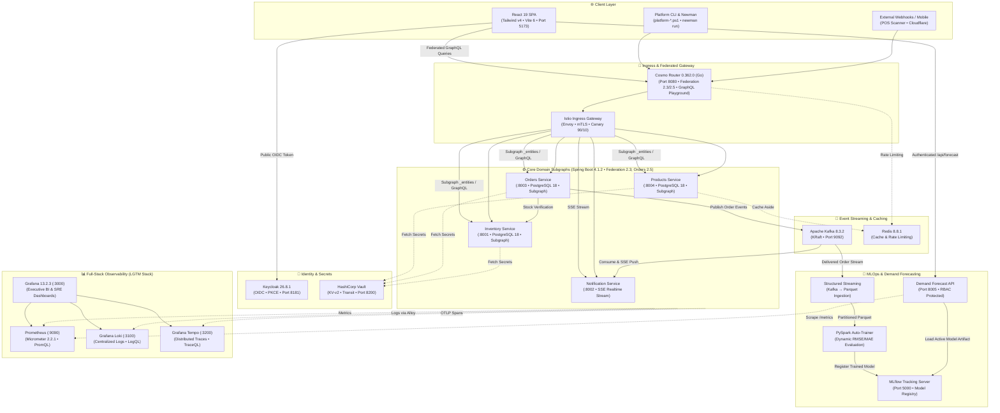
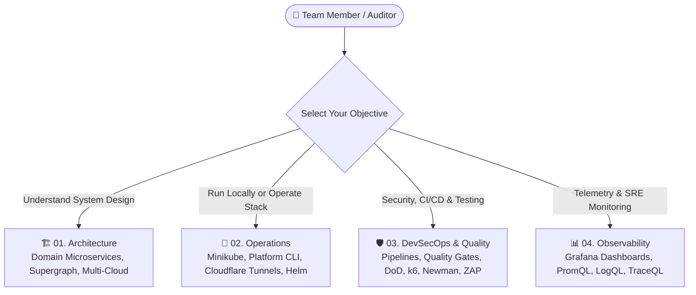

# 🏛️ Enterprise Microservices Architecture

<p align="center">
  
  
  
  
  
  
  
  
  
  
  
  
  
</p>

> **Enterprise Multi-Cloud Microservices Platform** built with **Java 21**, **Spring Boot 4.1.2**, and **React 19 + TailwindCSS v4**. Features automated **DHL tracking number generation**, observed **checkout-funnel event telemetry**, **Saga distributed transactions**, **Istio Service Mesh**, **HashiCorp Vault**, **Keycloak OAuth2/OIDC**, **KEDA v2.21.0 Event-Driven Autoscaling (Kafka Lag & Prometheus RPS)**, **Automated MLOps Demand Forecasting (PySpark Structured Streaming & MLflow)**, and full **DevSecOps & RBAC automation** across AWS, Azure, GCP, and local Minikube.

**Recommended local resources:** 8 CPU cores and 16 GB RAM free — the full local stack runs ~20+ containers.

For the canonical local host and Minikube resource profile, see [Local Deployment prerequisites](./docs/02-operations/LOCAL_DEPLOYMENT.md#-prerequisites). 

---

## 🏛️ Master Architecture Diagram


---

## 📚 Enterprise Documentation Hub & Architecture Blueprint

In-depth architectural specifications, multi-cloud topologies, operational runbooks, and quality gates are organized into **4 specialized pillars** under [`docs/`](./docs):

### 🧭 Navigation Matrix by Role



### 📑 Master Documentation Catalog

| Pillar | Focus & Key Contents | Core Documents | Target Audience |
| :--- | :--- | :--- | :--- |
| **01. Architecture** | Domain-Driven Design (DDD), Saga compensation, Keycloak 26 IAM, Vault secrets, React 19 context, multi-cloud infrastructure topologies (AWS, Azure, GCP), formalized Architecture Decision Records (ADRs), enterprise API design (RFC 7807 & GraphQL), and Business Continuity / Disaster Recovery (BCDR). | • [ARCHITECTURE.md](./docs/01-architecture/ARCHITECTURE.md)<br/>• [DISASTER_RECOVERY_STRATEGY.md](./docs/01-architecture/DISASTER_RECOVERY_STRATEGY.md)<br/>• [API_DESIGN_AND_CONTRACTS.md](./docs/01-architecture/API_DESIGN_AND_CONTRACTS.md)<br/>• [Architecture Decision Records (ADRs)](./docs/01-architecture/adr/README.md)<br/>• [MULTI_CLOUD_INFRASTRUCTURE.md](./docs/01-architecture/MULTI_CLOUD_INFRASTRUCTURE.md) | Software Architects, Developers |
| **02. Operations** | Full Docker Compose service stack, Minikube cluster setup, Istio service mesh, platform-specific PowerShell CLI entrypoints, Cloudflare Zero-Trust Tunnels, Helm Canary rollouts, production release criteria, and lightweight deployment patterns (ECS Fargate & EC2 Ansible). | • [LOCAL_DEPLOYMENT.md](./docs/02-operations/LOCAL_DEPLOYMENT.md)<br/>• [RELEASE_CRITERIA_AND_GOVERNANCE.md](./docs/02-operations/RELEASE_CRITERIA_AND_GOVERNANCE.md)<br/>• [LIGHTWEIGHT_DEPLOYMENT_PATTERNS.md](./docs/02-operations/LIGHTWEIGHT_DEPLOYMENT_PATTERNS.md)<br/>• [PLATFORM_CLI_REFERENCE.md](./docs/02-operations/PLATFORM_CLI_REFERENCE.md)<br/>• [CLOUDFLARE_TUNNELS.md](./docs/02-operations/CLOUDFLARE_TUNNELS.md)<br/>• [HELM_AND_CANARY.md](./docs/02-operations/HELM_AND_CANARY.md) | DevOps, Platform Engineers, SysAdmins |
| **03. DevSecOps & Testing** | Multi-CI/CD pipelines (GitHub Actions 12-stage, Azure DevOps 14-stage, Bitbucket 14-stage), Quality Gates (DoR/DoD), Newman contract tests, k6 load testing, OWASP ZAP DAST, Git workflows, and enterprise DevSecOps governance model & RACI matrix. | • [DEVSECOPS_GOVERNANCE_AND_MODEL.md](./docs/03-devsecops-and-testing/DEVSECOPS_GOVERNANCE_AND_MODEL.md)<br/>• [DEVSECOPS_PIPELINES.md](./docs/03-devsecops-and-testing/DEVSECOPS_PIPELINES.md)<br/>• [QUALITY_GATES_AND_DOD.md](./docs/03-devsecops-and-testing/QUALITY_GATES_AND_DOD.md)<br/>• [DYNAMIC_AND_CHAOS_TESTING.md](./docs/03-devsecops-and-testing/DYNAMIC_AND_CHAOS_TESTING.md)<br/>• [GIT_WORKFLOW_AND_COLLABORATION.md](./docs/03-devsecops-and-testing/GIT_WORKFLOW_AND_COLLABORATION.md) | SecOps, QA Engineers, Cloud Engineers, Architects |
| **04. Observability** | Full-stack LGTM telemetry handbook: PromQL queries (RED metrics, JVM, funnels), LogQL (Loki correlation), and TraceQL (Tempo distributed spans). | • [OBSERVABILITY_QUERIES.md](./docs/04-observability/OBSERVABILITY_QUERIES.md) | SRE, Operations Engineers |
| **API Collections** | Unified Newman & Postman API suite with Federation v2 queries, Keycloak login flows, and end-to-end order orchestration. | • [Postman Collection](./devsecops/testing/newman/microservices.postman_collection.json) | API Developers, QA |

### ⚡ Quick-Start Learning Pathways by Engineering Role

Select the recommended reading sequence tailored to your day-to-day responsibilities:

- **💻 Backend & Frontend Developers:**
  1. [01. System Architecture](./docs/01-architecture/ARCHITECTURE.md): Master domain boundaries, Saga transactions, and GraphQL federation schema.
  2. [02. Local Deployment Runbook](./docs/02-operations/LOCAL_DEPLOYMENT.md): Spin up the local Minikube cluster or Docker Compose stack in minutes.
  3. [03. Quality Gates & DoD](./docs/03-devsecops-and-testing/QUALITY_GATES_AND_DOD.md): Review acceptance criteria, pre-PR local maturity checks, and the unified PR template.

- **🛡️ DevSecOps, SRE & QA Engineers:**
  1. [03. DevSecOps Governance & Model](./docs/03-devsecops-and-testing/DEVSECOPS_GOVERNANCE_AND_MODEL.md): End-to-end 5-phase delivery model, BPMN lifecycle, role profiles, and organizational RACI matrix.
  2. [03. CI/CD Pipelines](./docs/03-devsecops-and-testing/DEVSECOPS_PIPELINES.md): Multi-cloud pipeline engine (GitHub Actions 12-stage, Azure DevOps 14-stage, Bitbucket 14-stage) and static checks (Gitleaks, Semgrep, Trivy, OPA).
  3. [03. Dynamic & Chaos Testing](./docs/03-devsecops-and-testing/DYNAMIC_AND_CHAOS_TESTING.md): Run Newman contract regressions, k6 performance/SLO gates, and OWASP ZAP DAST scans.
  4. [04. Observability Handbook](./docs/04-observability/OBSERVABILITY_QUERIES.md): Query metrics (PromQL), logs (LogQL), and distributed spans (TraceQL) across the Grafana LGTM stack.
  5. [02. Cloudflare Tunnels](./docs/02-operations/CLOUDFLARE_TUNNELS.md): Expose local or staging endpoints securely to remote GitHub Actions runners.

- **☁️ Cloud Platform & Infrastructure Architects:**
  1. [01. Multi-Cloud Infrastructure](./docs/01-architecture/MULTI_CLOUD_INFRASTRUCTURE.md): Review Terraform modules, provider architectures (AWS EKS, Azure AKS, GCP GKE), remote backends, and state locks.
  2. [02. Platform CLI Reference](./docs/02-operations/PLATFORM_CLI_REFERENCE.md): Single operational tool for cluster lifecycles, secrets, and canary routing.
  3. [02. Helm Chart & Canary Releases](./docs/02-operations/HELM_AND_CANARY.md): Manage Umbrella Helm chart delivery, OCI registries, and Istio canary traffic splitting.
  4. [03. Git Workflow & Rollbacks](./docs/03-devsecops-and-testing/GIT_WORKFLOW_AND_COLLABORATION.md): Release branching, hotfixes, GitOps ArgoCD syncs, and 4-tier disaster recovery.

### 🎨 Visual Architecture Blueprint

All visual architectural views are maintained in [`docs/Diagrams.drawio`](./docs/Diagrams.drawio) (viewable via [draw.io](https://app.diagrams.net/) or VS Code Draw.io extension):

| Tab # | View Name | Architectural Scope |
| :---: | :--- | :--- |
| **01** | *General Architecture & Microservices* | High-level topology across Client, Edge Nginx, Cosmo Router Gateway, Core Domain Microservices, Kafka Broker, PostgreSQL DBs, and LGTM Observability stack. |
| **02** | *HashiCorp Vault - Zero-Touch Security Architecture* | Zero-trust secrets management with Vault KV-v2 engine, Kubernetes Auth Method, AppRole authentication, dynamic secret injection, and least-privilege policies. |
| **03** | *Sequence - Dynamic Database Secret Rotation* | Detailed sequence diagram of automated dynamic PostgreSQL database credentials generation, lease lifecycle, and Spring Boot connection renewal. |
| **04** | *Istio Service Mesh & Zero-Trust mTLS* | Istio Ingress Gateway, Envoy sidecar injection, STRICT mutual TLS (`mTLS`), VirtualServices, DestinationRules, and Kiali mesh visualization. |
| **05** | *Secret Isolation & Configuration Precedence* | Three-tier configuration precedence and security boundaries across environment variables, HashiCorp Vault, and Kubernetes ConfigMaps. |
| **06** | *Kubernetes & Minikube Cluster Topology* | Multi-namespace architecture (`dev`, `istio-system`, `vault`, `observability`, `cert-manager`), NodePort mappings, resource limits, and persistent storage. |
| **07** | *End-to-End Request Flow & Order Processing Sequence* | Complete synchronous and asynchronous transaction flow: Keycloak JWT validation, Cosmo Router supergraph resolution, Saga orchestration, and Kafka notification dispatch. |
| **08** | *Mature E-Commerce Observability Architecture* | Unified LGTM telemetry pipeline: OpenTelemetry Collector, Prometheus TSDB, Grafana dashboards, Loki log streaming, and Tempo distributed tracing. |
| **09** | *Local DevSecOps Platform & GitHub Actions Delivery* | Pre-commit maturity gates, 7-step CI delivery workflow, SAST (Semgrep, Gitleaks), Trivy container scanning, OPA Conftest, and GitOps synchronization with ArgoCD. |
| **10** | *Resiliency, Secrets, Canary & Alerts* | Resilience4j circuit breakers, Istio Canary traffic shifting (10% to 100%), Alertmanager rules, and chaos resilience simulation. |
| **11** | *Multi-Cloud IaC & CLI Automation Suite* | Independent Minikube, AWS, Azure, and GCP CLI entrypoints, multi-cloud Terraform workspaces, OpenCost monitoring, and FinOps budgeting. |
| **12** | *Multi-Cloud CI/CD & Recovery Architecture* | Cross-cloud delivery matrix: GitHub Actions (12-stage DevSecOps flow + ArgoCD GitOps), Azure DevOps (14-stage AKS delivery), Bitbucket Pipelines (14-stage GKE delivery), and 4-tier disaster recovery. |
| **13** | *The 5-Phase End-to-End Delivery Lifecycle* | Enterprise DevSecOps governance, Shift-Left threat modeling, automated Level 1/2/3 Quality Gates, and continuous SRE closed-loop telemetry feedback. |
| **14** | *GraphQL Supergraph - 6-Layer Defense-in-Depth Architecture* | Edge protection, depth limiting (≤12), alias restriction (≤5), @authenticated pre-fetch field kill-switch, JWKS RS256 validation, and NetPol isolation. |
| **15** | *Sequence - GraphQL Supergraph Request Lifecycle & Edge Protection* | Chronological request lifecycle from React 19 client to Cosmo Router gateway, fail-closed validation forks, and parallel Apollo Federation v2 entity resolution. |
| **16** | *Agnostic POS QR Scanner & Omnichannel Architecture* | Omnichannel retail cashier workflow, dual-engine BarcodeDetector + jsQR decoding, camera race-condition lock, Nginx Permissions-Policy, PostgreSQL row locks, and live POS order fulfillment. |

---

## 🔌 Workload Matrix, Infrastructure Sizing & Cloud Target Mapping

The platform workloads, listener ports, container resource allocations (CPU/memory requests, limits, and PVC storage) across all 29 ecosystem components—including core microservices, IAM, datastores, MLOps, observability, and scaling operators—are centrally unified in the canonical **[Workload Matrix, Infrastructure Sizing & Cloud Target Mapping](./docs/01-architecture/ARCHITECTURE.md#-workload-matrix-infrastructure-sizing--cloud-target-mapping)** within `ARCHITECTURE.md`.

For the complete microservices catalog, API path routing, direct `localhost` access URLs, interactive OpenAPI 3.0 Swagger specifications, and administrative management consoles across both local direct port-forwards and Minikube NodePort topologies, refer to the complementary **[Unified Endpoints, API Routing & Swagger Access Matrix](./docs/01-architecture/ARCHITECTURE.md#-unified-endpoints-api-routing--swagger-access-matrix)** in `ARCHITECTURE.md`.

---

## ⚡ Core Enterprise Capabilities

The platform implements 6 core enterprise capabilities designed for high availability, zero-trust security, and cloud-native resilience. Complete technical specifications, state machines, and schemas are consolidated in the canonical [Enterprise Features & Platform Capabilities Catalog](docs/01-architecture/ARCHITECTURE.md#-enterprise-features--platform-capabilities-catalog).

| Capability Domain | Core Features & Implementation Highlights | Architectural Specification |
| :--- | :--- | :--- |
| **🛒 E-Commerce & Retail** | 3-step checkout funnel, automated DHL carrier tracking (`DHL-XXXXXXXX`), WebRTC camera & USB wedge scanner, user-scoped SSE notifications, verified reviews & best seller badges | [Detailed Spec](docs/01-architecture/ARCHITECTURE.md#1--e-commerce--retail-innovation) |
| **🔄 Distributed Reliability** | Saga compensation stock rollback, distributed UUIDv4 idempotency with Redis `SETNX`, Resilience4j circuit breakers, Kafka Dead Letter Topics (`.DLT`) | [Detailed Spec](docs/01-architecture/ARCHITECTURE.md#2--distributed-reliability--consistency) |
| **🛡️ Zero-Trust Security** | Keycloak 26.8.1 OIDC PKCE flow, HashiCorp Vault v2.2.0 dynamic secrets & transit encryption, OPA Gatekeeper admission control, Sigstore Cosign image provenance | [Detailed Spec](docs/01-architecture/ARCHITECTURE.md#3--zero-trust-security--devsecops-governance) |
| **🧪 Automated MLOps** | Real-time Kafka Structured Streaming to Parquet, continuous PySpark GBT regressor auto-training, MLflow Champion/Challenger model registry, 7-day inference API | [Detailed Spec](docs/01-architecture/ARCHITECTURE.md#4--automated-mlops--demand-forecasting) |
| **📊 Full-Stack Observability** | Unified LGTM stack (Loki, Grafana, Tempo, Prometheus), Grafana Explore correlation, Kiali service mesh visualizer, OpenCost real-time FinOps telemetry | [Detailed Spec](docs/01-architecture/ARCHITECTURE.md#5--full-stack-observability-lgtm-stack) |
| **📱 Mobile & Edge Readiness** | Clean architecture boundary for React Native / Expo, Google Play Store publication readiness, Cloudflare Anycast zero-trust edge tunnels for serverless Vercel clients | [Detailed Spec](docs/01-architecture/ARCHITECTURE.md#6--client-agnostic-mobile--edge-networking) |

---

## 🚀 Quick Start (Up in 3 Minutes)

### Option A: Local Docker Compose (Default Platform Stack)

The fastest way to spin up the complete ecosystem including all microservices, databases, Keycloak, Vault, and Grafana:

```powershell
# 1. Clone the repository
git clone https://github.com/georgegxx/microservices-architecture.git && cd microservices-architecture

# 2. Copy environment file if not already present and define the passwords
cp .env.example .env

# 3. Start Keycloak and its database in detached mode
docker compose up -d --build keycloak

# 4. Native PowerShell script (auto-syncs client secret into .env):
pwsh -File .\scripts\bootstrap-keycloak.ps1

# 5. Launch all Compose services, including MLflow and the forecast API:
docker compose up -d --build

# 6. Verify healthy startup across all containers:
docker compose ps -a
docker compose ps --format "table {{.Name}}\t{{.State}}\t{{.Ports}}"

# 7. Graceful shutdown (preserves named volumes and MLflow runs)
docker compose --profile "*" down -v
```
Use `docker compose down -v` only when you intentionally want to delete persisted Compose data, including MLflow runs and model artifacts.
> 🧪 **MLOps & Demand Forecasting Quick Commands:**
> - Run containerized PySpark baseline training: `.\mlops\training.ps1 -Target compose`
> - Simulate 14-day Kafka order ingestion and auto-training cycle: `.\mlops\training.ps1 -Target compose -SimulateOrders -Days 14`
> - For Parquet streaming partitions, dual MLflow port handling, and background capture, see the [Docker Compose MLOps Runbook](docs/02-operations/LOCAL_DEPLOYMENT.md#5--local-mlops-workflow-with-docker-compose).

---

### Option B: Local Kubernetes on Minikube (Enterprise DevSecOps)

To deploy the entire production-grade stack on Minikube with **Istio Service Mesh**, **OPA Gatekeeper**, and **Helm**:

```powershell
# 1. Audit host CLI dependencies:
.\platform-minikube.ps1 tools

# 2. Deploy the full ecosystem (Minikube, Istio, Gatekeeper, Vault, Keycloak, Apps):
.\platform-minikube.ps1 up -Environment dev -WithIstio

# 3. Verify platform health, pods, NodePorts, and Gatekeeper OPA policies:
.\platform-minikube.ps1 doctor -Environment dev

# 4. Supervise background tunnels and display interactive endpoints table:
.\platform-minikube.ps1 tunnels
.\platform-minikube.ps1 urls

# 5. Pause cluster (preserves storage, database state, and volumes):
.\platform-minikube.ps1 down

# 6. Fast-resume stack in < 30 seconds (bypassing Terraform, Gatekeeper, and Helm packaging):
.\platform-minikube.ps1 start                       # Default with Istio
.\platform-minikube.ps1 start -WithoutIstio         # Fast resume in lightweight native mode
.\platform-minikube.ps1 start -DeployCanary -CanaryImageTag v2.1  # Fast resume with canary active

# 7. Complete purge when no longer needed:
.\platform-minikube.ps1 down -Destroy
```

> 🧪 **Minikube MLOps Auto-Training Quick Command:**
> - Simulate 14 days of delivered orders and trigger the guarded training scheduler: `.\mlops\training.ps1 -Target minikube -SimulateOrders -Days 14`
> - For PVC storage details, CronJob scheduler logic, and Champion/Challenger model governance, see the [Minikube MLOps Deployment Runbook](docs/02-operations/LOCAL_DEPLOYMENT.md#5--minikube-mlops-deployment--automated-dynamic-training).

> 📘 **Step-by-step Minikube Deep-Dive:** Detailed hardware allocation, standalone host development, network topologies, Canary traffic routing, and DNS setup are available in [docs/02-operations/LOCAL_DEPLOYMENT.md](./docs/02-operations/LOCAL_DEPLOYMENT.md).

---

## 🧪 Automated Testing & Simulation Suite

The platform provides an automated test, simulation, and quality gate suite orchestrated directly through `platform-minikube.ps1`:

```powershell
# 1. Functional smoke checks across Router, REST subgraphs, and Auth
.\platform-minikube.ps1 smoke

# 2. Legitimate E-Commerce User Traffic Simulation (Funnel events + real checkouts)
.\platform-minikube.ps1 simulate -Scenario traffic -Orders 15

# 3. Unified component and telemetry diagnostics (Swagger, PromQL, Grafana, Series)
.\platform-minikube.ps1 diagnose

# 4. Newman API Contract Suite (23 Requests, including MLOps 7-day forecast & RBAC)
.\platform-minikube.ps1 contract

# 5. k6 Performance & SLO latency benchmark in containerized runtime
.\platform-minikube.ps1 performance

# 6. OWASP ZAP Dynamic Application Security Testing (DAST) baseline scan
.\platform-minikube.ps1 dast

# 7. Shift-Left Security Scans (Gitleaks, TFLint, Trivy, OPA Conftest, Cosign)
.\platform-minikube.ps1 security-scan

# 8. Java 21 + Maven Reactor Unit Tests across microservices
.\platform-minikube.ps1 test

# 9. MLOps Quality & Model Governance Suite (15 automated tests)
$env:PYTHONPATH = "mlops"; python -m unittest discover -s mlops/tests -v
```

> 📖 **Comprehensive Testing Runbook:** For circuit breaker chaos drills, rate-limiting DDoS probes, and k6 SLA thresholds, see the [Dynamic Testing & Chaos Engineering Guide](docs/03-devsecops-and-testing/DYNAMIC_AND_CHAOS_TESTING.md).

---

## 📁 Repository Structure

```text
microservices-architecture/
├── .github/workflows/              # ⚙️ GitHub Actions CI/CD (service build, container registry & GitOps)
├── ansible/                        # 🤖 Ansible Automation for Compact Host Deployments
│   ├── inventory/hosts.ini         # Dynamic EC2 host inventory
│   ├── playbooks/deploy-compact-stack.yml # Master Docker, UFW & Systemd deployment
│   └── templates/                  # Compose stack & multi-DB initialization
├── argocd/                         # 🐙 ArgoCD GitOps Applications & ApplicationSets (dev, staging, prod)
├── azure-devops/                   # 🔷 Azure DevOps Pipeline definitions
├── backups/                        # 💾 BCDR disaster recovery drills & automated database snapshots
├── cosmo-router/                   # 🌐 Cosmo Router Federation v2 Gateway (Port 8080)
├── devsecops/                      # 🛡️ Centralized DevSecOps Security Hub
│   ├── compliance/                 # Sigstore Cosign keys, JVM pinned certs & Trivy configs
│   ├── dast/zap/                   # OWASP ZAP automation plan (zap.yaml) & rule calibrations
│   ├── policies/                   # Policy-as-Code (Conftest pre-deploy & Gatekeeper admission)
│   ├── sast/gitleaks/              # Hardcoded credential detection (.gitleaks.toml)
│   └── testing/                    # k6 performance SLOs & Newman integration test collections
├── docs/                           # 📚 Enterprise Platform Documentation (4 Specialized Pillars)
│   ├── 01-architecture/            # ADRs, System Architecture, Disaster Recovery & Multi-Cloud
│   ├── 02-operations/              # Minikube, Governance, Cloudflare Tunnels & Helm Canary
│   ├── 03-devsecops-and-testing/   # Governance Model, CI/CD Pipelines, Quality Gates, Chaos & Git Workflow
│   ├── 04-observability/           # Telemetry Handbook, PromQL, LogQL & TraceQL queries
│   ├── reference/                  # OpenAPI specifications, Keycloak realm exports & SQL schemas
│   └── Diagrams.drawio             # 🎨 16-Page Comprehensive Architectural Blueprint (Draw.io)
├── frontend/                       # 💻 React 19 + TailwindCSS v4 SPA (Port 3000 • Nginx Distroless)
├── helm/                           # ⎈ Kubernetes Helm Packaging
│   ├── charts/                     # Individual service subcharts (products, orders, inventory, etc.)
│   ├── microservices-umbrella/     # Master umbrella chart orchestrating the complete platform
│   └── values/                     # Environment-specific configuration overrides (dev, staging, prod)
├── inventory-service/              # 📦 Inventory & Stock Allocation Service (Port 8001 • Spring Boot)
├── k8s/                            # ☸️ Kubernetes & Service Mesh Manifests
│   ├── common/                     # Core namespaces, RBAC roles & StorageClasses
│   ├── istio/                      # VirtualServices, DestinationRules, Gateway & mTLS policies
│   ├── minikube/                   # Local cluster deployment manifests & local secrets
│   └── [aks|eks|gke]/              # Managed cloud Kubernetes configurations
├── mlops/                          # 🧪 MLOps Pipeline & Forecasting Service
│   ├── capture_orders.py           # Unified Kafka event capture (Spark Parquet & Python CSV)
│   ├── train_demand_model.py       # PySpark MLlib GBT regressor, MLflow tracking & auto-trainer
│   ├── forecast_api.py             # FastAPI 7-day SKU demand inference endpoint with Keycloak RBAC
│   ├── generate_sample_sales.py    # Synthetic seasonal historical sales dataset generator
│   └── container_train.sh          # Containerized headless PySpark training entrypoint
├── notification-service/           # 🔔 Kafka Event Consumer & SSE Notification Stream (Port 8002 • Spring Boot)
├── observability/                  # 📊 Full-Stack LGTM Observability Platform
│   ├── alloy/                      # Grafana Alloy OpenTelemetry telemetry collector config
│   ├── grafana/                    # Provisioned datasources and dynamic dashboards
│   └── [loki|tempo|prometheus]/    # Log aggregation, distributed tracing & metrics backends
├── orders-service/                 # 🛒 Order Orchestration & Saga Coordinator (Port 8003 • Spring Boot)
├── products-service/               # 🏷️ Product Catalog Domain Service (Port 8004 • Spring Boot)
├── scripts/                        # ⚡ Enterprise Platform Automation & Verification Suite
│   ├── testing/                    # Consolidated diagnostic engine (diagnose.py, simulate.py, smoke.py)
│   ├── bcdr-simulation.ps1         # Disaster recovery GameDay & backup verification runner
│   ├── bootstrap-keycloak.ps1      # Keycloak 26 IAM realm bootstrapper & client secret sync
│   ├── build-all.py                # Concurrent Java & React container image compiler
│   ├── generate-secure-secrets.py  # CSPRNG cryptographic secret & JWT key generator
│   ├── local-cost-estimator.py     # Unified FinOps suite (Terraform plan-delta & K8s right-sizing)
│   ├── manage-cloudflare-tunnels.ps1 # Cloudflare Zero Trust tunnel manager & DNS sync
│   └── update_dashboards.py        # Grafana dashboard generator & live publisher
├── terraform/                      # 🌍 Multi-Cloud Infrastructure as Code (IaC)
│   ├── backend-config/             # Remote state backend definitions (S3, Azure Blob, GCS)
│   ├── environments/               # Target workspaces (aws, azure, gcp, dev, staging, prod)
│   └── modules/                    # Reusable cloud modules (VPC, EKS, AKS, GKE, RDS, Vault)
├── .env.example                    # Environment variables template
├── .gitattributes                  # Git line-ending and binary attributes configuration
├── .gitignore                      # Git ignore patterns
├── .gitleaksignore                 # Baseline allowlist and suppressions for secrets scanner
├── bitbucket-pipelines.yml         # Bitbucket Pipelines CI/CD configuration
├── compose.yaml                    # Local multi-service development stack (15 containers)
├── LICENSE                         # MIT License file
├── platform-minikube.ps1           # Local Minikube platform CLI & lifecycle orchestrator
├── platform-multicloud.ps1         # Multi-Cloud (AWS, Azure, GCP) Enterprise Orchestrator
├── pom.xml                         # Maven Multi-Module Reactor (Java 21, Spring Boot 4.1.2)
├── README.md                       # Master architecture documentation & quickstart guide
└── sonar-monorepo-projects.json    # SonarQube / SonarCloud multi-module matrix metadata
```
---

## 📄 License

This project is licensed under the **MIT License** — see the [LICENSE](LICENSE) file for details.
