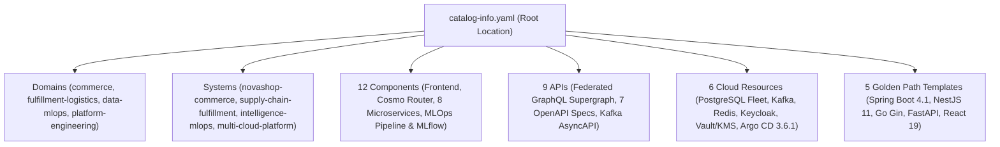

# Backstage Internal Developer Portal (IDP) Architecture & Governance

## 1. Strategic Purpose & Operational Independence

Backstage (`v1.36.0`) serves as the **Internal Developer Portal (IDP)** for the Enterprise Multi-Cloud Microservices Platform, unifying:
- **Software Catalog** (`catalog-info.yaml`, `backstage/catalog/*`)
- **Golden Path Software Templates** (`backstage/templates/*`)
- **TechDocs Documentation-as-Code** (`mkdocs.yml`)
- **GitOps, Observability & DevSecOps Visibility** (Argo CD `v3.6.1`, Prometheus, Grafana, SonarQube Cloud, Semgrep, Trivy, Cosign)

### Non-Negotiable Operational Independence
Backstage is strictly an **observability, governance, and developer self-service portal** — it is **never** in the critical runtime or deployment path:
1. **Runtime Independence:** Customer and API traffic flows through Cloudflare/Ingress -> Istio Ambient Mesh -> `cosmo-router` -> Backend Microservices. If Backstage is unavailable, zero customer or API requests are impacted.
2. **CI/CD & GitOps Independence:** GitHub Actions (AWS EKS + Argo CD 3.6.1), Azure DevOps (Azure AKS + Helm), and Bitbucket Pipelines (GCP GKE + Helm) execute independently of Backstage availability.
3. **Security Gate Independence:** OPA Gatekeeper admission control, Conftest Rego validation, Trivy scanning, Semgrep SAST, Gitleaks secret detection, and Cosign OCI signature verification never depend on Backstage.

---

## 2. Catalog Entity Model & Ownership

---

## 3. Identity, Authentication & RBAC Mapping

Backstage authenticates users via **Keycloak OIDC (`microservices-realm`)** (`backstage/app-config.yaml` and `backstage/app-config.production.yaml`) and enforces role-based access control (`backstage/rbac-policy.csv`):

| Keycloak OIDC Group | Backstage Role | Catalog Permissions | Scaffolder Permissions |Entity Deletion |
|---|---|---|---|---|
| `platform-admins` | `role:default/platform-admin` | Read, Create, Refresh, Delete | Execute all Golden Path templates | Allowed |
| `devops-engineers` | `role:default/devops-engineer` | Read, Refresh | Execute all Golden Path templates | Denied |
| `developers` | `role:default/developer` | Read | Execute Golden Path service/app templates | Denied |

---

## 4. Golden Path Scaffolder Security Controls

All 5 Golden Path templates under `backstage/templates/` adhere to strict supply-chain security controls:
- Only declarative actions (`fetch:template`, `publish:github:pull-request`, `catalog:register`) are permitted.
- Arbitrary shell execution (`execute:shell`) is strictly prohibited.
- Input parameters enforce strict regex validation (`^[a-z][a-z0-9-]*-service$`).
- All scaffolded changes open pull requests that must pass Gitleaks, Semgrep (`v1.110.0`), Trivy (`v0.76.1`), Conftest (`v0.58.0`), and SonarQube Cloud quality gates before merge.
