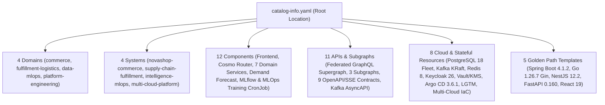

# Backstage Internal Developer Portal (IDP) Architecture & Governance

## 1. Strategic Purpose & Operational Independence

Backstage (`v1.56.3`) serves as the **Interactive Internal Developer Portal (IDP)** for the Enterprise Multi-Cloud Microservices Platform, unifying:
- **Software Catalog** (`catalog-info.yaml`, `backstage/catalog/*`)
- **Interactive Cluster Health, API Explorer & Dependency Topology** (`/.backstage/health/v1/*`, `/api/live/status`, `/api/live/execute`)
- **Golden Path Software Templates & Live Scaffolder** (`backstage/templates/*`, `/api/scaffolder/generate`)
- **TechDocs Documentation-as-Code** (`mkdocs.yml`)
- **GitOps, Observability & DevSecOps Visibility** (Argo CD `v3.6.1`, Prometheus, Grafana, SonarQube Cloud, Semgrep, Trivy, Cosign, and 2-Version SemVer Docker Hub Release Retention)

### Non-Negotiable Operational Independence
Backstage is strictly an **observability, governance, and developer self-service portal** — it is **never** in the critical runtime or deployment path:
1. **Runtime Independence:** Customer and API traffic flows through Cloudflare/Ingress -> Istio Ambient Mesh -> `cosmo-router` -> Backend Microservices. If Backstage is unavailable, zero customer or API requests are impacted.
2. **CI/CD & GitOps Independence:** GitHub Actions (AWS EKS + Argo CD 3.6.1), Azure DevOps (Azure AKS + Helm), and Bitbucket Pipelines (GCP GKE + Helm) execute independently of Backstage availability.
3. **Security Gate Independence:** OPA Gatekeeper admission control, Conftest Rego validation, Trivy scanning, Semgrep SAST, Gitleaks secret detection, and Cosign OCI signature verification never depend on Backstage.

---

## 2. Catalog Entity Model & Ownership

---

## 3. Identity, Authentication & RBAC Mapping

Backstage authenticates users via **Keycloak OIDC (`microservices-realm`)** (`backstage/app-config.yaml` and `backstage/app-config.production.yaml`) and enforces role-based access control (`backstage/rbac-policy.csv`):

| Keycloak OIDC Group | Backstage Role | Catalog Permissions | Scaffolder Permissions |Entity Deletion |
|---|---|---|---|---|
| `platform-admins` | `role:default/platform-admin` | Read, Create, Refresh, Delete | Execute all Golden Path templates | Allowed |
| `devops-engineers` | `role:default/devops-engineer` | Read, Refresh | Execute all Golden Path templates | Denied |
| `developers` | `role:default/developer` | Read | Execute Golden Path service/app templates | Denied |

---

## 4. Golden Path Scaffolder Security Controls

All 5 Golden Path templates under `backstage/templates/` adhere to strict supply-chain security controls:
- Only declarative actions (`fetch:template`, `publish:github:pull-request`, `catalog:register`) are permitted.
- Arbitrary shell execution (`execute:shell`) is strictly prohibited.
- Input parameters enforce strict regex validation (`^[a-z][a-z0-9-]*-service$`).
- All scaffolded changes open pull requests that must pass Gitleaks, Semgrep (`v1.110.0`), Trivy (`v0.76.1`), Conftest (`v0.58.0`), and SonarQube Cloud quality gates before merge.

---

## 5. Interactive Self-Service Capabilities & Network Isolation

In local/Minikube clusters (`k8s/minikube/infra/backstage.yaml`), Backstage IDP (`v1.56.3`, port `7007`) exposes four interactive self-service capabilities governed by two dedicated Zero-Trust `NetworkPolicy` resources (`backstage-idp-netpol` and `allow-backstage-idp-probes`):

| Endpoint / Capability | Method | Architectural Behavior |
|---|---|---|
| `/api/catalog/entities` | `GET` | Serves the unified catalog graph (4 Domains, 4 Systems, 12 Components, 11 APIs/Subgraphs, 8 Resources, 5 Templates, 3 OIDC Groups). |
| `/api/live/status` | `GET` | Performs real-time in-cluster HTTP readiness probes across all 16 targets (11 HTTP microservices/UI, `mlops-training-pipeline` CronJob registry check via MLflow, plus Keycloak, Vault, Argo CD, and Prometheus), returning HTTP status and latency in milliseconds. |
| `/api/live/execute` | `POST` | Interactive API & GraphQL Explorer executing live queries against internal Kubernetes ClusterIP DNS targets (e.g., Federated Supergraph queries on `cosmo-router:8080/graphql`, Subgraph SDL introspection, OpenAPI `/v3/api-docs`, and MLflow experiments) without CORS friction. |
| `/api/scaffolder/generate` | `POST` | Interactive Golden Path Scaffolder generating compliant `catalog-info.yaml`, GitHub Actions `service-<name>.yml` (with 2-version SemVer Docker Hub retention), and hardened non-root Helm values (`UID 1001`, `readOnlyRootFilesystem: true`, KEDA `ScaledObject`). |
