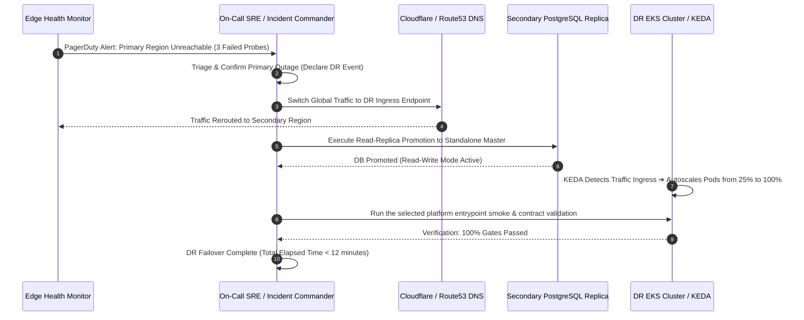
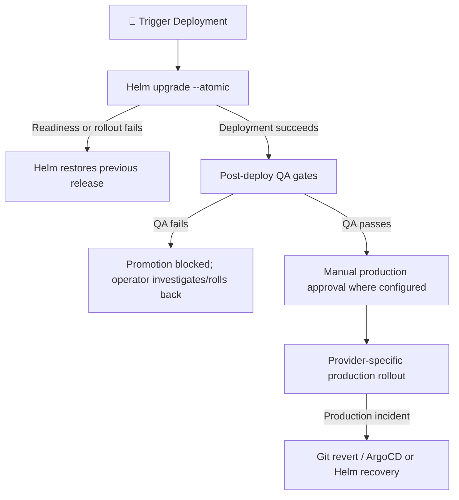

# 🛡️ Business Continuity & Disaster Recovery (BCDR) Strategy

> [!TIP]
> 🧭 **[Enterprise Platform Hub](../../README.md)** > **01. Architecture** > `DISASTER_RECOVERY_STRATEGY.md`

This document defines the target **Business Continuity and Disaster Recovery (BCDR)** architecture for the microservices platform, informed by **ISO 22301** (Business Continuity Management) and **NIST SP 800-34** (Contingency Planning for Federal Information Systems). These are design objectives; they are not a claim of certified compliance or measured production recovery performance.

---

## 🎯 Executive Summary & Objectives

The target architecture is designed to improve service recovery during catastrophic failures such as regional cloud outages, ransomware incidents, or accidental administrative state loss.

### Target Service Level Objectives (SLOs)
* **High Availability (HA):** 99.95% uptime across Multi-AZ intra-region infrastructure.
* **Disaster Recovery (DR):** Cross-region **Warm Standby** architecture ensuring failover within minutes.

The current local Minikube backup implementation writes PostgreSQL dumps to a cluster-local PVC and verifies checksum plus isolated restores. It does not provide cross-region replication, off-cluster immutable storage, or measured RTO/RPO. Treat the objectives and topology below as targets until cloud resources, failover automation, and scheduled GameDays are implemented and measured.

---

## 📊 Business Impact Analysis (BIA): RTO & RPO Tiers

Every service and stateful store is categorized by business criticality to optimize the cost-to-resilience ratio:

```mermaid
quadrantChart
    title BIA Service Criticality Matrix (RTO vs RPO)
    x-axis Low RTO (Minutes) --> High RTO (Hours)
    y-axis High RPO (Hours) --> Low RPO (Seconds)
    quadrant-1 Low Urgency
    quadrant-2 Tier 1: Mission Critical (Orders, Keycloak, Postgres)
    quadrant-3 Tier 2: Business Operational (Inventory, Products, Router)
    quadrant-4 Tier 3: Async & Observability (Notifications, LGTM)
    "Orders Service": [0.15, 0.90]
    "Keycloak IAM": [0.10, 0.95]
    "PostgreSQL Data": [0.10, 0.98]
    "Cosmo Router": [0.20, 0.70]
    "Inventory Service": [0.25, 0.75]
    "Products Service": [0.25, 0.65]
    "Kafka KRaft": [0.20, 0.85]
    "Notification Service": [0.60, 0.40]
    "Observability LGTM": [0.75, 0.30]
```

| Criticality Tier | Workload / Data Store | Maximum Tolerable Downtime (RTO) | Maximum Data Loss (RPO) | Resiliency & Recovery Architecture |
| :--- | :--- | :---: | :---: | :--- |
| **Tier 1: Mission-Critical** | • `orders-service`<br/>• `keycloak` IAM<br/>• PostgreSQL Databases | **< 15 minutes** | **< 1 minute** | Multi-AZ Primary + Cross-Region Asynchronous Read Replica with fast promotion; continuous WAL archiving to S3 WORM Object Lock. |
| **Tier 2: Business-Operational** | • `cosmo-router`<br/>• `products-service`<br/>• `inventory-service`<br/>• Apache Kafka KRaft | **< 30 minutes** | **< 5 minutes** | Active cluster standby; Kafka MirrorMaker 2.0 active topic replication; ArgoCD automated GitOps state convergence. |
| **Tier 3: Async & Observability** | • `notification-service`<br/>• Redis Cache<br/>• LGTM Stack (Loki, Tempo, Prometheus) | **< 2 hours** | **< 1 hour** | Ephemeral cache rebuilt from source DBs; asynchronous notification retries; cold storage metric snapshots. |

---

## 🏗️ Cross-Region Architecture: Warm Standby Topology

```mermaid
graph TD
    Client[Global Clients & Edge Traffic] -->|Anycast Routing| Edge[Cloudflare Zero-Trust / Route53]
    
    subgraph "Primary Region (AWS us-east-1 / Active)"
        Edge -->|Primary Active (100% Traffic)| Ingress1[Istio Ingress Gateway]
        Ingress1 --> EKS1[EKS Cluster Primary]
        EKS1 --> App1[Microservices + Router]
        App1 --> DB1[(RDS PostgreSQL 18 Multi-AZ)]
        App1 --> K1[Kafka KRaft Primary]
        App1 --> R1[(Redis ElastiCache Primary)]
    end

    subgraph "Continuous Data Replication"
        DB1 -->|Cross-Region Streaming Replication| DB2[(RDS PostgreSQL Standby Replica)]
        DB1 -->|Continuous WAL Archiving| S3WORM[S3 Immutable Backup Object Lock]
        K1 -->|MirrorMaker 2.0 Topic Sync| K2[Kafka KRaft Standby]
    end

    subgraph "Secondary DR Region (AWS us-west-2 / Warm Standby)"
        Edge -.->|Automated DNS Failover < 30s| Ingress2[Istio Ingress Gateway DR]
        Ingress2 --> EKS2[EKS Cluster DR 25% Baseline]
        EKS2 --> App2[Microservices Standby / KEDA Autoscalers]
        App2 -.->|Promoted on Failover| DB2
        App2 -.-> K2
        App2 -.-> R2[(Redis Standby Cache)]
    end
```

### Key Architectural Tenets:
1. **Edge Anycast & Health Probes:** Cloudflare Zero-Trust Anycast monitors the primary Ingress endpoint (`/health`). Upon 3 consecutive failed probes (15 seconds), traffic automatically reroutes to the secondary region.
2. **Baseline Warm Standby:** The DR EKS cluster runs 25% of standard pod replicas. When failover traffic arrives, **KEDA** (Kubernetes Event-driven Autoscaling) detects the incoming request rate and scales pods to 100% in under 45 seconds.
3. **Storage Immutability (WORM):** Database WAL backups are sent to S3 with **Object Lock** in *Compliance Mode* (Write Once, Read Many), preventing ransomware or compromised administrative credentials from wiping out historical restore points.

---

## 🔄 Disaster Recovery Runbooks

### Runbook 1: Automated / Assisted Failover Procedure



#### Detailed Execution Steps:
1. **Triage & Declaration:** Incident Commander verifies via cloud provider health status that the primary region is unrecoverable within the RTO budget.
2. **Database Promotion:**
   ```bash
   # AWS CLI RDS Promotion
   aws rds promote-read-replica \
     --db-instance-identifier microservices-prod-dr-replica \
     --region us-west-2
   ```
3. **DNS Traffic Shift:**
   Update Cloudflare DNS pool or Route53 Failover record to point `api.microservices.example.com` to the DR Network Load Balancer (NLB).
4. **Scale-up Workloads:**
   KEDA automatically scales deployments upon receiving traffic. Alternatively, manually patch replica counts:
   ```bash
   kubectl scale deployment cosmo-router --replicas=4 -n dev
   kubectl scale deployment orders-service --replicas=4 -n dev
   ```
5. **Post-Failover Verification:**
   Run the repository's smoke and contract verification jobs against the DR
   endpoint from CI. Cloud provider entrypoints manage infrastructure and
   GitOps operations, not local application test runners.

---

### Runbook 2: Failback Procedure (Return to Primary Region)

> [!CAUTION]
> Never perform failback during active peak business hours. Schedule a planned maintenance window to avoid dual-master split-brain scenarios.

1. **Re-establish Primary Infrastructure:** Verify primary region availability and apply Terraform configurations to confirm zero drift:
   ```bash
   terraform -chdir=terraform/environments/aws plan
   ```
2. **Reverse Database Synchronization:** Configure the primary database as a read-replica of the DR database to capture data generated during the outage:
   ```bash
   # Re-sync delta from us-west-2 back to us-east-1
   aws rds create-db-instance-read-replica \
     --db-instance-identifier microservices-prod-primary-resync \
     --source-db-instance-identifier arn:aws:rds:us-west-2:ACCOUNT:db:microservices-prod-dr \
     --region us-east-1
   ```
3. **Drain Traffic & Switch DNS:** Temporarily enable maintenance mode, verify replica catch-up (Replication Lag = 0 seconds), promote primary DB, and switch DNS back to `us-east-1`.
4. **Decommission DR Over-Provisioning:** Scale DR cluster back to its 25% baseline footprint.

---

### Runbook 3: PostgreSQL Data Backup, Checksum & Isolated Restore

PostgreSQL databases (`ms_orders`, `ms_products`, `ms_inventory`, `ms_keycloak`) store bounded context state.

#### 1. Live Backup Generation (Custom Format)
```powershell
# Docker Compose:
docker compose exec -T db-orders pg_dump --no-owner --no-privileges --format=custom -U postgres -d ms_orders -f /tmp/ms_orders.dump
docker compose cp db-orders:/tmp/ms_orders.dump backups/local-drills/ms_orders.dump

# Kubernetes (e.g. Orders Pod):
kubectl exec -n data db-orders-0 -c postgres -- pg_dump -U postgres -d ms_orders --no-owner --no-privileges --format=custom --file=/tmp/ms_orders.dump
kubectl cp data/db-orders-0:/tmp/ms_orders.dump backups/bcdr-drill/ms_orders.dump -c postgres
```

#### 2. Integrity Verification & Isolated Drill Restore
```bash
# Verify archive TOC integrity
pg_restore --list backups/local-drills/ms_orders.dump

# Isolated restore into temporary database
docker compose exec -T db-orders psql -U postgres -d postgres -c "CREATE DATABASE restore_drill_test;"
docker compose cp backups/local-drills/ms_orders.dump db-orders:/tmp/restore_drill.dump
docker compose exec -T db-orders pg_restore --exit-on-error --no-owner --no-privileges -U postgres -d restore_drill_test /tmp/restore_drill.dump

# Validate table count parity between production and restored drill database
docker compose exec -T db-orders psql -U postgres -d restore_drill_test -c "SELECT count(*) FROM information_schema.tables WHERE table_schema='public';"
docker compose exec -T db-orders dropdb -U postgres --force restore_drill_test
```

---

### Runbook 4: Apache Kafka Topic Metadata, Offset & Replay Recovery

Kafka stores in-flight business events (`orders-topic`, `orders-topic.DLT`).

#### 1. Topic Definition & Consumer Group Offset Backup
```bash
# Export topic definitions and partition configurations
docker compose exec -T kafka kafka-topics --bootstrap-server localhost:9092 --describe > backups/local-drills/kafka-topics-metadata.txt

# Export active consumer group offsets
docker compose exec -T kafka kafka-consumer-groups --bootstrap-server localhost:9092 --all-groups --describe > backups/local-drills/kafka-consumer-groups.txt

# Dump unconsumed/recent messages from orders-topic
docker compose exec -T kafka kafka-console-consumer \
  --bootstrap-server localhost:9092 \
  --topic orders-topic \
  --from-beginning \
  --max-messages 500 \
  --timeout-ms 5000 > backups/local-drills/orders-topic-messages.jsonl
```

#### 2. Kafka Topic Disaster Restoration & Replay Drill
```bash
# 1. Recreate topic if missing or corrupted
docker compose exec -T kafka kafka-topics --bootstrap-server localhost:9092 --create \
  --topic orders-topic \
  --partitions 3 \
  --replication-factor 1 \
  --if-not-exists

# 2. Replay messages into an isolated recovery drill topic
docker compose exec -T kafka kafka-topics --bootstrap-server localhost:9092 --create \
  --topic orders-topic-drill-restore --partitions 1 --replication-factor 1

# 3. Stream backed up events to restore topic
cat backups/local-drills/orders-topic-messages.jsonl | docker compose exec -T kafka \
  kafka-console-producer --bootstrap-server localhost:9092 --topic orders-topic-drill-restore

# 4. Verify message count and payload integrity
docker compose exec -T kafka kafka-console-consumer \
  --bootstrap-server localhost:9092 \
  --topic orders-topic-drill-restore \
  --from-beginning --max-messages 1 --timeout-ms 5000
```

---

### Runbook 5: MLOps MLflow Tracking & Artifact Store Recovery

MLflow maintains model experiments, hyperparameters, and serialized PySpark / scikit-learn models.

#### 1. Atomic Online Backup of MLflow SQLite Database & Artifacts
```bash
# Atomic online SQLite snapshot without taking MLflow offline
docker compose exec -T mlflow python -c "import sqlite3; s = sqlite3.connect('/mlflow-data/mlflow.db'); b = sqlite3.connect('/tmp/mlflow-backup.sqlite'); s.backup(b); b.close(); s.close()"
docker compose cp mlflow:/tmp/mlflow-backup.sqlite backups/local-drills/mlflow-backup.sqlite

# Archive artifact store directory
docker compose exec -T mlflow tar -czf /tmp/mlflow-artifacts.tar.gz -C /mlflow-artifacts .
docker compose cp mlflow:/tmp/mlflow-artifacts.tar.gz backups/local-drills/mlflow-artifacts.tar.gz
```

#### 2. Integrity Check & Isolated Drill Restoration
```bash
# Verify SQLite table structure and run integrity
python -c "import sqlite3; conn = sqlite3.connect('backups/local-drills/mlflow-backup.sqlite'); c = conn.cursor(); c.execute('PRAGMA integrity_check;'); print('Integrity:', c.fetchone()[0]); c.execute('SELECT count(*) FROM runs;'); print('Registered MLflow Runs:', c.fetchone()[0]); conn.close()"

# The unified drill extracts the archive to an isolated directory and compares
# SHA-256 manifests against the source artifact store.
pwsh -File .\scripts\bcdr-simulation.ps1 -Action VerifyBackups -Component MLflow
```

#### 3. Automated Unified BCDR Drill Execution
To execute the supported local drills in one pass and receive an SRE audit table:
```powershell
# Run against local Docker Compose (PostgreSQL, Kafka, MLflow)
.\scripts\bcdr-simulation.ps1 -Action VerifyBackups -Component All

# Run against Kubernetes cluster
.\scripts\bcdr-simulation.ps1 -Action SimulateFailover -Component All -Environment dev
```

The Compose Kafka drill exports topic and consumer-group diagnostics, then restores up to 100 retained `orders-topic` records into a temporary topic and compares the replayed payloads. It requires at least one retained record. The MLflow drill restores the SQLite backup to a temporary file, checks SQLite integrity, extracts the artifact archive to an isolated directory, and compares SHA-256 manifests. These local checks verify backup contents; they do not measure production RPO/RTO or perform cross-region failover.

---

### Runbook 6: Application Release Rollback (Helm, GitOps & Multi-CI/CD)

Recovery behavior depends on the deployment path. Helm atomic upgrades restore the prior release when deployment readiness fails; later QA failures block promotion and require an operator to redeploy/rollback. ArgoCD recovery is performed by reverting Git or using its rollback controls.



#### 1. Universal Direct Kubernetes / Helm CLI
To immediately inspect revision history and roll back in any cluster (Minikube, EKS, AKS, GKE):
```bash
# View deployment revision history:
helm history microservices -n staging
helm history microservices -n production

# Roll back to the immediately preceding revision:
helm rollback microservices -n staging
helm rollback microservices -n production

# Roll back to a specific revision (e.g. revision 3):
helm rollback microservices 3 -n production --wait --timeout 5m
```

#### 2. Declarative GitOps Rollback (ArgoCD)
* **The GitOps Way (Recommended):** Revert the commit in Git so that Git history remains the single source of truth:
  ```bash
  git revert HEAD
  git push origin main
  ```
  ArgoCD detects the revert and automatically reconciles (`selfHeal: true`) the cluster to the restored state.
* **Emergency UI / CLI Rollback:**
  * In the **ArgoCD Web Console**: Navigate to the application (`microservices-prod`) ➔ Click **History and Rollback** ➔ Select desired revision ➔ Click **Rollback** (temporarily pauses auto-sync until the incident is investigated).
  * Via ArgoCD CLI:
    ```bash
    argocd app rollback microservices-prod <revision-id>
    ```

#### 3. Multi-CI/CD Automated & Assisted Rollbacks
* **GitHub Actions:** If a release fails during staging verification, the `rollback-staging` job executes automatically. To redeploy an earlier release manually, open **Actions** ➔ Select workflow ➔ Click **Run workflow** ➔ Select target branch or tag.
* **Azure DevOps:** The `RollbackStaging` stage automatically triggers whenever `IntegrationTests`, `E2ETests`, `PerformanceTests`, or `DASTScan` fail. To redeploy a previous build: Open **Pipelines** ➔ Select prior successful run ➔ Click **Run new** or **Redeploy stage**.
* **Bitbucket Pipelines:** A failed Helm upgrade uses `--atomic`; deployment-step errors attempt rollback when an earlier release exists. For post-deployment gate failures, use `helm rollback microservices <revision> -n <namespace> --wait`.

---

## 💾 Kubernetes State Protection with Velero (v1.18.3)

While all application configurations and deployments are stored declaratively in Git (GitOps via ArgoCD), stateful PersistentVolumeClaims (PVCs) and dynamically generated Secrets/Certificates are backed up via **Velero v1.18.3** with Kopia `nodeAgent` (`defaultVolumesToFsBackup: true`):

### Automated Velero Deployment & Schedule:
- **CLI Installer:** [`scripts/install-velero.sh`](../../scripts/install-velero.sh) (pins `v1.18.3` across Linux/macOS architectures).
- **Cluster Helm Values:** [`k8s/common/bcdr/velero-values.yaml`](../../k8s/common/bcdr/velero-values.yaml).
- **Automated Deployment Script:** [`scripts/deploy-velero.sh`](../../scripts/deploy-velero.sh).
- **Production Schedule Manifest:** [`k8s/common/bcdr/velero-schedule.yaml`](../../k8s/common/bcdr/velero-schedule.yaml).
- **Postgres BCDR Engine:** [`scripts/prod/pg-bcdr-engine.sh`](../../scripts/prod/pg-bcdr-engine.sh).

```yaml
apiVersion: velero.io/v1
kind: Schedule
metadata:
  name: microservices-cluster-bcdr-schedule
  namespace: velero
spec:
  schedule: "0 2 * * *" # Every day at 02:00 UTC
  template:
    includedNamespaces:
      - dev
      - auth
      - data
      - vault
      - istio-system
    snapshotVolumes: true
    defaultVolumesToFsBackup: true
    ttl: 720h0m0s # 30 Days Retention
```

### Full Cluster Disaster Recovery Commands:
```bash
# Complete restoration on a freshly provisioned cluster
velero restore create --from-backup microservices-cluster-bcdr-schedule-20261002020000

# Standalone database restoration & verification drills via production Bash engine:
./scripts/prod/pg-bcdr-engine.sh backup --all --dest backups/bcdr-drill
./scripts/prod/pg-bcdr-engine.sh verify-drill --file backups/bcdr-drill/ms_orders_20261002.dump
./scripts/prod/pg-bcdr-engine.sh restore --file backups/bcdr-drill/ms_orders_20261002.dump --target-db ms_orders
```

---

## 🎲 Chaos Engineering & Disaster Recovery Drills (GameDays)

To validate that procedures work in reality and not just on paper, the team conducts **semi-annual DR GameDays**:

1. **Simulated Scenarios:**
   * **Chaos Drill 1:** Sudden termination of primary database instance (Failover validation).
   * **Chaos Drill 2:** Blackhole network egress on primary Kafka broker (Resilience & idempotency check).
   * **Chaos Drill 3:** Simulated entire-region loss via DNS blackhole routing.
2. **Validation Criteria:**
   * Actual RTO $\le 15$ minutes.
   * Actual RPO $\le 1$ minute (Zero lost committed orders).
   * No data corruption in PostgreSQL bounded contexts.
