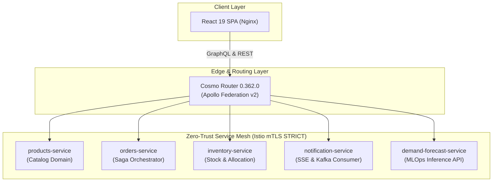

# 🏗️ Pillar 01: System Architecture & Technical Design

> [!TIP]
> 🧭 **[Enterprise Platform Hub](../../README.md)** > **01. System Architecture & Technical Design**

---

## 🎯 Domain Overview

The **System Architecture & Technical Design** pillar defines the blueprint of the platform. It establishes the principles of GraphQL federation, bounded domain microservices, database-per-service isolation, asynchronous event streaming with Kafka, Zero-Trust security with HashiCorp Vault and Keycloak, and multi-cloud resilience across AWS, Azure, and Google Cloud Platform.

---

## 📚 Document Index & Recommended Reading Order

| # | Document | Primary Persona | Strategic Scope & Key Takeaways |
| :-: | :--- | :--- | :--- |
| **1** | [**ARCHITECTURE.md**](./ARCHITECTURE.md) | Software Architects, Tech Leads | Master blueprint: Federated GraphQL schema, bounded contexts, Saga choreography, Spring Boot 4 / Java 21 reactor, and POS barcode engine. |
| **2** | [**API_DESIGN_AND_CONTRACTS.md**](./API_DESIGN_AND_CONTRACTS.md) | Backend Engineers, QA | OpenAPI 3.0 specs, RFC 7807 Problem Details error formats, RESTful standards, and Newman contract validation. |
| **3** | [**MULTI_CLOUD_INFRASTRUCTURE.md**](./MULTI_CLOUD_INFRASTRUCTURE.md) | Cloud Engineers, DevOps | Terraform architecture for AWS (EKS), Azure (AKS), and GCP (GKE), remote state backends, and zero-lock-in networking. |
| **4** | [**DISASTER_RECOVERY_STRATEGY.md**](./DISASTER_RECOVERY_STRATEGY.md) | SREs, Risk & Compliance | Business Impact Analysis (BIA), Warm Standby topology, RTO/RPO SLAs, and PostgreSQL / Kafka / MLflow recovery runbooks. |
| **5** | [**ADR Catalog (Architecture Decision Records)**](./adr/README.md) | Entire Engineering Team | ADR-001 through ADR-010 documenting design decisions (Federation, Event Sourcing, IAM, Vault, KEDA, LGTM). |

---

## 🧭 Platform Documentation Pillars

* 🏗️ **Pillar 01:** System Architecture (You are here)
* 🚀 **[Pillar 02: Operations & Local Deployment](../02-operations/README.md)**
* 🛡️ **[Pillar 03: DevSecOps, Governance & Testing](../03-devsecops-and-testing/README.md)**
* 📊 **[Pillar 04: Observability & Telemetry](../04-observability/README.md)**
