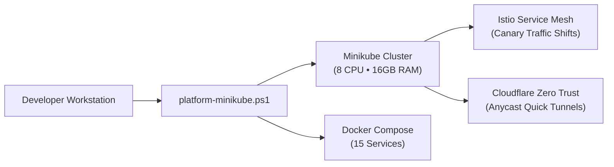

# 🚀 Pillar 02: Platform Operations & Local Deployment

> [!TIP]
> 🧭 **[Enterprise Platform Hub](../../README.md)** > **02. Platform Operations & Local Deployment**

---

## 🎯 Domain Overview

The **Platform Operations & Local Deployment** pillar establishes standard operational runbooks for running, scaling, and managing the microservices platform across local environments (Minikube / Docker Compose), progressive traffic routing (Istio Canary), secure ingress (Cloudflare Zero Trust Tunnels), and cost-effective cloud deployments (AWS ECS / EC2 Ansible).

---

## 📚 Document Index & Recommended Reading Order

| # | Document | Primary Persona | Strategic Scope & Key Takeaways |
| :-: | :--- | :--- | :--- |
| **1** | [**LOCAL_DEPLOYMENT.md**](./LOCAL_DEPLOYMENT.md) | Developers, DevOps | End-to-end Minikube and Docker Compose setup, 21-tool prerequisite matrix, Vault unseal, MLOps pipeline, and teardown. |
| **2** | [**PLATFORM_CLI_REFERENCE.md**](./PLATFORM_CLI_REFERENCE.md) | Platform Engineers | Complete syntax reference for `platform-minikube.ps1` and `platform-multicloud.ps1` (45+ lifecycle, DevSecOps & FinOps commands). |
| **3** | [**HELM_AND_CANARY.md**](./HELM_AND_CANARY.md) | Release Engineers, SREs | Umbrella chart architecture, subchart values, progressive Istio Canary rollouts (10% → 100%), and automatic rollbacks. |
| **4** | [**CLOUDFLARE_TUNNELS.md**](./CLOUDFLARE_TUNNELS.md) | SecOps, Network Admins | Zero-Trust ingress without open inbound firewall ports, edge SSL offloading, and dynamic public DNS hostname synchronization. |
| **5** | [**LIGHTWEIGHT_DEPLOYMENT_PATTERNS.md**](./LIGHTWEIGHT_DEPLOYMENT_PATTERNS.md) | Cloud Architects | Cost-optimized production alternatives: AWS ECS Fargate serverless containers and single-node EC2 with Ansible automation. |
| **6** | [**RELEASE_CRITERIA_AND_GOVERNANCE.md**](./RELEASE_CRITERIA_AND_GOVERNANCE.md) | Release Managers, QA | Per-service SLOs (99.95% availability, p95 latencies), resource bounds, actionable Prometheus alerts, and rollback triggers. |

---

## 🧭 Platform Documentation Pillars

* 🏗️ **[Pillar 01: System Architecture & Technical Design](../01-architecture/README.md)**
* 🚀 **Pillar 02:** Platform Operations & Local Deployment (You are here)
* 🛡️ **[Pillar 03: DevSecOps, Governance & Testing](../03-devsecops-and-testing/README.md)**
* 📊 **[Pillar 04: Observability & Telemetry](../04-observability/README.md)**
