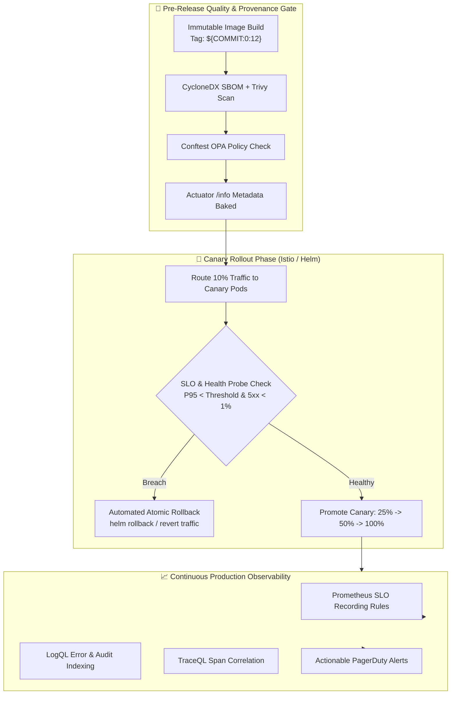

# 🚀 Production Release Criteria & Operational Governance Framework

> [!TIP]
> 🧭 **[Enterprise Platform Hub](../../README.md)** > **02. Operations** > `RELEASE_CRITERIA_AND_GOVERNANCE.md`

> Enterprise engineering standard for production release qualification across microservices, MLOps engines, and edge routing. Defines explicit Service Level Objectives (SLOs), actionable alert definitions, compute resource limits, automated rollback triggers, and runtime version evidence verification.

> **Profile scope:** SLO values below are proposed objectives. CPU/memory and JVM settings must be read from the selected Compose or Helm profile; this matrix is not itself a deployment configuration or an automatic rollback gate. Only checks wired into the relevant pipeline are enforced automatically.

---

## 📌 Executive Summary & Operational Tenets

In a distributed, event-driven microservices architecture, observability must not be confined to post-incident metric visualization. Instead, observability metrics and telemetry bounds form the **enforceable contract for production releases**.

### Core Operational Tenets:
1. **No Deployment Without Measurable SLOs:** Every microservice must publish availability, error budget burn, and latency distributions via Micrometer / Prometheus metrics.
2. **Deterministic Version & Build Evidence:** Every deployed pod must expose immutable provenance (git commit SHA, build timestamp, semver tag) via its `/info` Actuator endpoint and OpenTelemetry resource attributes.
3. **Hard Cgroup Resource Isolation:** Unbounded memory and CPU configurations are strictly prohibited. JVM heaps must be explicitly anchored between 50% and 70% of pod container limits to prevent cgroup `OOMKilled` termination cascades.
4. **Automated Rollback-on-Failure:** Deployment pipelines enforce automated rollback upon Kubernetes readiness failure (`--atomic`) or Istio canary error budget breach (> 1% 5xx).



---

## 📊 Comprehensive Per-Service Release Specification Matrix

| Service | Primary Stack & Port | Availability Target (30d) | Latency Objective (P95) | CPU Request / Limit | Memory Request / Limit | JVM Heap (-Xms / -Xmx) | Rollback Trigger | Version Evidence Verification |
| :--- | :--- | :---: | :---: | :---: | :---: | :---: | :---: | :--- |
| **`cosmo-router`** | Cosmo Router / Go (`8080`) | **99.95%** | **< 150 ms** | Profile-managed | Profile-managed | N/A (compiled binary) | Error rate > 2% or 3 failed `/health` probes | `GET /health` + header `wgc-router-version` |
| **`orders-service`** | Spring Boot 4.0.9 (`8003`) | **99.90%** | **< 350 ms** | Profile-managed | Profile-managed | Profile-managed | 5xx ratio > 1% in canary or DB pool drop | `GET /actuator/orders/info` |
| **`products-service`** | Spring Boot 4.0.9 (`8004`) | **99.90%** | **< 200 ms** | Profile-managed | Profile-managed | Profile-managed | P95 > 500ms or 3 consecutive probe failures | `GET /actuator/products/info` |
| **`inventory-service`** | Spring Boot 4.0.9 (`8001`) | **99.90%** | **< 200 ms** | Profile-managed | Profile-managed | Profile-managed | Redis connectivity loss or 5xx > 1% | `GET /actuator/inventory/info` |
| **`notification-service`** | Spring Boot 4.0.9 (`8002`) | **99.50%** | **< 500 ms** | Profile-managed | Profile-managed | Profile-managed | Kafka consumer lag > 1000 msgs for 15m | `GET /actuator/notification/info` |
| **`frontend`** | React 19 / Nginx (`5173`) | **99.95%** | **< 100 ms** | 50m / 250m | 64Mi / 256Mi | N/A (Static asset server) | Nginx 5xx > 1% or healthz timeout | `GET /healthz` + meta tag version |
| **`demand-forecast-service`** | FastAPI / Python (`8005`) | **99.50%** | **< 800 ms** | Profile-managed | Profile-managed | N/A (Uvicorn / scikit-learn) | Model age > 7d or RMSE > 15.0 | `GET /health` + `GET /api/forecast` metadata |
| **`demand-sales-capture`** | PySpark 4.2 Streaming | **99.50%** | N/A (Stream) | Profile-managed | Profile-managed | Profile-managed | Query crash loop or checkpoint corruption | Pod logs + Spark UI `/jobs` |

---

## 🔍 Detailed Service Criteria Specifications

### 1. `cosmo-router` (GraphQL Supergraph Gateway)
* **Function:** Federated GraphQL execution engine and entry point for external traffic.
* **SLOs:**
  * **Availability:** ≥ 99.95% across 30 days.
  * **Latency:** P95 ≤ 150 ms, P99 ≤ 400 ms.
* **Resource Bounds:**
  * Request: `100m` CPU, `128Mi` RAM.
  * Limit: `500m` CPU, `512Mi` RAM.
* **Actionable Alerts:**
  * `CosmoRouterDown`: Target unreachable for > 3 minutes (Critical).
  * `CosmoRouterHighErrorRate`: Supergraph 5xx failure rate > 5% for > 5 minutes (Warning).
  * `CosmoRouterHighLatency`: P95 request duration > 1000 ms for > 5 minutes (Warning).
* **Rollback Trigger:** Automatic Helm rollback if readiness probe (`/health`) fails 3 times with 10s timeout, or Istio canary reports > 2% 5xx during the 10-minute traffic shift.
* **Version Evidence:** Header `wgc-router-version` and Cosmo execution config hash in logs.

---

### 2. `orders-service` (Spring Boot 4.0.9)
* **Function:** Mission-critical transactional checkout, order placement, status lifecycle, and Kafka event publishing.
* **SLOs:**
  * **Availability:** ≥ 99.90% across 30 days.
  * **Latency:** P95 ≤ 350 ms, P99 ≤ 800 ms.
  * **Error Budget:** 5-minute burn rate threshold = 7.2% (14.4x normal consumption).
* **Resource Bounds:**
  * Request: `250m` CPU, `512Mi` RAM.
  * Limit: `1000m` CPU, `1024Mi` RAM.
  * JVM Heap: `-Xms256m -Xmx600m` (Preserves ~424 MiB headroom for Metaspace, threads, Netty buffers).
* **Actionable Alerts:**
  * `ServiceDown`: Pod unreachable for > 3 minutes (Critical).
  * `MicroserviceAvailabilityErrorBudgetBurn`: 5m & 1h error ratios > 7.2% (Critical).
  * `HighLatency`: P95 HTTP duration > 1.0s for > 5 minutes (Warning).
  * `HikariPoolExhaustion`: Active connection ratio > 85% for > 2 minutes (Warning).
* **Rollback Trigger:** Readiness probe failure (`/actuator/orders/health/readiness`), uncaught `SQLException` spike > 3%, or circuit breaker open state.
* **Version Evidence:**
  * Query endpoint: `GET /actuator/orders/info`
  * Expected JSON payload:
    ```json
    {
      "app": {
        "name": "orders-service",
        "description": "Transactional Order Management Service"
      },
      "build": {
        "version": "1.0.0",
        "artifact": "orders-service",
        "time": "2026-10-20T10:00:00Z"
      },
      "git": {
        "commit": {
          "id": "3dc45b7a1209",
          "time": "2026-10-20T09:45:00Z"
        },
        "branch": "develop"
      }
    }
    ```

---

### 3. `products-service` & `inventory-service` (Spring Boot 4.0.9)
* **Function:** Product catalog indexing, pricing, inventory reservation, and Redis cache synchronization.
* **SLOs:**
  * **Availability:** ≥ 99.90%.
  * **Latency:** P95 ≤ 200 ms, P99 ≤ 500 ms.
* **Resource Bounds:**
  * Request: `200m` CPU, `384Mi` RAM.
  * Limit: `800m` CPU, `768Mi` RAM.
  * JVM Heap: `-Xms192m -Xmx450m`.
* **Actionable Alerts:**
  * `RedisExporterDown`: Redis cluster/instance unreachable for > 2 minutes (Critical).
  * `HighHeapUsage`: JVM memory utilization > 75% for > 10 minutes (Warning).
* **Rollback Trigger:** Inability to obtain database connection or unhandled Redis command timeouts during canary warm-up.
* **Version Evidence:** `GET /actuator/products/info` and `GET /actuator/inventory/info`.

---

### 4. `notification-service` (Spring Boot 4.0.9 / Kafka Consumer)
* **Function:** Asynchronous customer order dispatch notification, email dispatch, and dead-letter queue (DLT) processing.
* **SLOs:**
  * **Availability:** ≥ 99.50%.
  * **Processing Lag:** Consumer offset lag ≤ 100 messages under normal traffic.
* **Resource Bounds:**
  * Request: `150m` CPU, `384Mi` RAM.
  * Limit: `500m` CPU, `768Mi` RAM.
  * JVM Heap: `-Xms192m -Xmx450m`.
* **Actionable Alerts:**
  * `KafkaConsumerHighLag`: Partition lag > 1000 messages for > 15 minutes (Warning).
  * `KafkaDLTSpike`: More than 5 messages sent to `orders-topic.DLT` within 1 minute (Critical).
* **Rollback Trigger:** Container CrashLoopBackOff or partition revocation storm.
* **Version Evidence:** `GET /actuator/notification/info`.

---

### 5. `demand-forecast-service` (FastAPI MLOps Inference)
* **Function:** Machine learning inference API exposing 7-day SKU demand forecasts based on active champion model from MLflow.
* **SLOs:**
  * **Availability:** ≥ 99.50%.
  * **Latency:** P95 ≤ 800 ms, P99 ≤ 1500 ms.
* **Resource Bounds:**
  * Request: `250m` CPU, `512Mi` RAM.
  * Limit: `1000m` CPU, `1536Mi` RAM.
* **Actionable Alerts:**
  * `MLOpsModelStale`: Active model trained > 7 days ago without retraining (Warning).
  * `MLOpsDataFreshnessLag`: Input sales dataset contains no events in the last > 3 days (Warning).
  * `MLOpsHighModelRMSE`: Model RMSE > 15.0 units (Warning).
  * `MLOpsNoActiveModel`: No registered model serving predictions (Critical).
* **Rollback Trigger:** Data contract schema violation or MLflow artifact fetch exception returning HTTP 503.
* **Version Evidence:**
  * Response body from `GET /api/forecast`:
    ```json
    {
      "horizonDays": 7,
      "dataSource": "captured-sales",
      "modelRunId": "b18b4e7243c9429188e734c264d85206",
      "modelCreatedAt": "2026-10-20T10:00:00Z"
    }
    ```

---

## 🛡️ Release Qualification & Rollback Protocol

Before promoting any container image to staging or production, the release operator or automated CI/CD pipeline must execute the standard qualification sequence:

```powershell
# 1. The Spark training job enforces the data quality and freshness gate before feature engineering.
# It exits without logging/promoting a model if the gate fails.
docker compose --profile training run --rm demand-model-training --input-parquet /data/sales_parquet

# 2. Run Full End-to-End User Journey Verification
python scripts/testing/test-e2e-journey.py --router-url http://127.0.0.1:8080 --forecast-url http://127.0.0.1:8005

# 3. Verify Version Evidence Across Services
Invoke-RestMethod -Uri "http://localhost:8003/actuator/orders/info" | ConvertTo-Json
Invoke-RestMethod -Uri "http://localhost:8004/actuator/products/info" | ConvertTo-Json
Invoke-RestMethod -Uri "http://localhost:8001/actuator/inventory/info" | ConvertTo-Json
Invoke-RestMethod -Uri "http://localhost:8002/actuator/notification/info" | ConvertTo-Json
Invoke-RestMethod -Uri "http://localhost:8005/health" | ConvertTo-Json

# 4. Execute BCDR Backup & Recovery Drill
.\scripts\bcdr-simulation.ps1 -Action VerifyBackups -Component All
```

### Automated Rollback Actions:
* **Helm Deployment Failure:** All deployments specify `--atomic --timeout 5m`. If any container fails to pass its readiness probe within 5 minutes, Helm automatically purges the new ReplicaSet and rolls back to the prior stable revision.
* **Istio Canary Degradation:** During progressive traffic rollouts (`10% -> 25% -> 50% -> 100%`), if Prometheus indicates `MicroserviceAvailabilityErrorBudgetBurn` or P95 latency exceeds the service SLO threshold, the traffic VirtualService immediately snaps back to `100% stable / 0% canary`.

---

## 📦 Immutable Release Delivery & Rollback Runbook

### 1. Essential Elements of a Production Release
Every release candidate promoted to production must contain:
1. **Immutable SemVer 2.0.0 Tag:** Semantic version string (`v1.0.0`, `v1.0.1`, `v1.1.0`) enforcing Docker Hub's **"All tags are immutable"** protection. Tags are never reused or overwritten.
2. **Container Registry Image & Digest:** Published under `georgegxx/<service>:<semver>` with its immutable cryptographic content addressable identifier (`sha256:...`).
3. **Supply Chain Provenance (Sigstore Cosign):** Cryptographically signed container image verifiable against [`cosign.pub`](../../devsecops/compliance/cosign/cosign.pub) before admission into the cluster.
4. **SBOM & Clean Security Gate:** CycloneDX SBOM generated and zero unaddressed CRITICAL vulnerabilities confirmed by Trivy.
5. **GitOps Desired State Declaration:** Pinned version or digest committed to `helm/microservices-umbrella/values.yaml` or target environment values.
6. **Backward-Compatible Database Migrations:** Database schema migrations (Liquibase/Flyway/PostgreSQL) strictly following the *Expand/Contract* pattern so that rolling back to version $N-1$ never corrupts active persistent data.

### 2. Zero-Downtime Switch Procedure to a New Version
When promoting a new version (e.g. `1.0.1`):
1. **Trigger the Release Pipeline:**
   - **Via GitHub Actions UI:** Navigate to **Actions** -> **Container Release Pipeline**, specify `version: 1.0.1`, and click **Run workflow**.
   - **Via Git Release Tag:**
     ```bash
     git tag v1.0.1
     git push origin v1.0.1
     ```
2. **Synchronize GitOps (ArgoCD):**
   Update the image tag in Helm values and synchronize ArgoCD:
   ```bash
   argocd app set microservices-dev --helm-set orders-service.image.tag="1.0.1"
   argocd app sync microservices-dev
   ```
3. **Rolling Update Execution:**
   - Kubernetes pulls the new `1.0.1` image (single pull per node).
   - The new pod starts up and executes its `readinessProbe` (`/actuator/<service>/health` or `/healthz`).
   - Active user traffic continues routing to `1.0.0` until `1.0.1` reports `200 OK`.
   - Kubernetes completes traffic switch and gracefully terminates `1.0.0` pods with zero downtime.

### 3. Emergency & Operational Rollback Procedures
If a regression or critical incident occurs, execute one of the following three rollback mechanisms:

#### A. GitOps Commit Revert (Standard Audit-Compliant Rollback)
```bash
git revert HEAD
git push origin develop
# ArgoCD reconciles the restored desired state automatically
```

#### B. ArgoCD Emergency Revision Rollback
```bash
# List historical application revisions
argocd app history microservices-dev

# Immediately roll back to previous deployment ID (e.g. revision 12)
argocd app rollback microservices-dev 12
```

#### C. Kubernetes Native Deployment Rollout Undo (Instant Recovery)
```bash
# Roll back orders-service to its prior stable ReplicaSet
kubectl rollout undo deployment/orders-service -n dev

# Confirm healthy rollout status
kubectl rollout status deployment/orders-service -n dev
```
