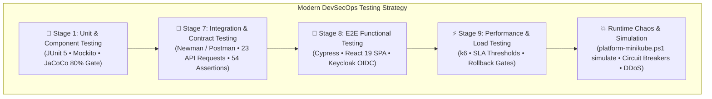
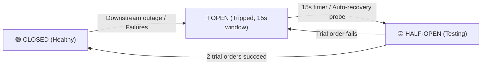

# 🧪 Automated Testing, Load Simulation & Chaos Engineering Guide

> [!TIP]
> 🧭 **[Enterprise Platform Hub](../../README.md)** > **03. DevSecOps & Testing** > `DYNAMIC_AND_CHAOS_TESTING.md`

> Practical execution handbook for synthetic shopper traffic, GraphQL load probes, checkout validation, E2E smoke checks, and the Newman API test suite.

---

## 🎯 Testing Ecosystem Architecture & Technology Selection Rationale

The platform follows a modern **Cloud-Native DevSecOps Testing Pyramid**, distributing test responsibilities across purpose-built tools instead of relying on legacy monolithic suites:



### 1. Technology Purpose & Responsibility Matrix

| Technology | Layer / Stage | Purpose & Operational Scope | Execution Environment |
| :--- | :--- | :--- | :--- |
| **JUnit 5 + Mockito** | **Stage 1 (Unit)** | Validates individual Java classes, business domain validation, and Saga state transitions in complete isolation with mock dependencies. | Maven Runner (`mvn test`) |
| **JaCoCo** | **Stage 1 (Coverage)** | Enforces code quality gates requiring ≥80% line and branch coverage before code can be packaged into containers. | Maven Plugin (`jacoco:report`) |
| **Newman (Postman CLI)** | **Stage 7 (Integration)** | Runs the repository collection through the frontend Nginx proxy, covering GraphQL/REST responses, Keycloak logins, and order lifecycle assertions. | Container / CLI (`newman run`) |
| **Cypress** | **Stage 8 (E2E)** | Executes real end-to-end user journeys inside the browser: login via Keycloak PKCE, product catalog browsing, cart operations, and order placement. | Headless Chrome/Electron in CI/CD |
| **Grafana k6** | **Stage 9 (Performance)** | Generates concurrent load to validate system throughput, latency percentiles (p95 < 500 ms), and Resilience4j circuit breaker thresholds. | Lightweight Go binary in CI/CD |
| **`simulate` / `smoke`** | **Runtime / Chaos** | `.\platform-minikube.ps1 simulate` generates shopper/chaos traffic; `.\platform-minikube.ps1 smoke` provides functional and bounded GraphQL resilience modes. | Minikube CLI (`.\platform-minikube.ps1 simulate / smoke`) |

---

### 2. Architectural Decisions: Why Not Apache JMeter or Selenium?

#### A. Grafana k6 vs. Apache JMeter (Load & Performance Testing)

* **Lightweight Container Footprint:** JMeter requires a heavy Java Virtual Machine (JVM) and significant memory just to boot the test runner. **k6** is a single compiled Go binary (~30 MB) that executes with minimal CPU and memory overhead, ideal for ephemeral CI/CD runners.
* **Test-as-Code vs. Monolithic XML:** JMeter tests are saved in complex, fragile XML (`.jmx`) files that are difficult to review in Pull Requests and prone to merge conflicts. **k6** scripts are written in standard JavaScript/TypeScript, enabling modularization, clean Git versioning, and shared libraries.
* **Native LGTM Stack Integration:** k6 streams metrics natively to **Prometheus** and **Grafana**, plotting real-time virtual users, request duration percentiles ($p_{90}, p_{95}, p_{99}$), and HTTP error rates directly on the platform's SRE dashboards.
* **Automated CI/CD Quality Gates & Rollbacks:** k6 supports declarative SLA thresholds in code (e.g. `http_req_duration: ['p(95)<500']`). If performance degrades under load, k6 exits with a non-zero code that immediately trips **Automated Rollback (Stage 10.1 / Stage 12.1)**.

#### B. Cypress vs. Selenium WebDriver (E2E Functional Testing)

* **React 19 Concurrent Rendering Compatibility:** Selenium operates out-of-process, sending remote HTTP commands via WebDriver protocol (`chromedriver`), introducing network latency and frequent timing issues (*flaky tests* due to `StaleElementReferenceException`). **Cypress** runs directly inside the browser's execution loop, automatically synchronizing with React 19 fiber reconciler transitions, hooks, Context state, and DOM updates without arbitrary `Thread.sleep()`.
* **Keycloak OIDC & Network Interception:** Cypress provides native network interception (`cy.intercept()`), allowing seamless inspection of Keycloak Bearer tokens, token refresh simulation, and deterministic API stubbing without running external HTTP proxies (like BrowserMob).
* **Developer Experience & CI/CD Artifacts:** Cypress automatically captures DOM snapshots, video recordings, and screenshots upon test failure, enabling instant root-cause analysis in CI/CD artifact tabs without configuring third-party listeners.

---

## 🧪 Automated Testing, Load Simulation & Chaos Engineering

For a bounded two-VU GraphQL latency/error baseline and a non-destructive local
PostgreSQL backup/restore drill, see [Quality Gates & DoD](./QUALITY_GATES_AND_DOD.md).
The local bounded GraphQL baseline is available through `smoke.py --resilience`; it does not place orders or generate attack traffic. CI performance gates continue using k6, and neither baseline replaces an explicitly planned capacity test.

Enterprise testing scripts located in `scripts/testing/` (fully orchestrated via `.\platform-minikube.ps1`):

### 1. 🛒 Legitimate E-Commerce Traffic Generator (`platform-minikube.ps1 simulate`)
Simulates shopping journeys through Cosmo Router GraphQL, sends funnel events through the frontend REST proxy, and places authenticated orders.

```powershell
# Run a default batch of 15 orders:
.\platform-minikube.ps1 simulate

# Place custom number of orders with specified concurrency:
.\platform-minikube.ps1 simulate -Orders 50 -Concurrency 5

# Run continuous background shopper simulation:
.\platform-minikube.ps1 simulate -Continuous
```

### 2. ⚡ Resilience4j Circuit Breaker State Verification
Test the automatic failure detection and self-healing lifecycle:



> [!NOTE]
> **Why Red only lasts 15 seconds:** `waitDurationInOpenState` is set to 15 seconds with `automaticTransitionFromOpenToHalfOpenEnabled: true`. Once tripped into **🔴 RED (`OPEN`)**, it will automatically transition to **🟡 YELLOW (`HALF_OPEN`)** after 15s of silence to test for backend recovery.

#### Step-by-Step Test Procedure:

##### 🔴 Step A: Trip Circuit Breaker into OPEN (Red `#ef4444`)
Simulate downstream outage by stopping `inventory-service` and generating continuous traffic so the Red state remains continuously visible on Grafana without expiring:
```powershell
# 1. Stop inventory dependency:
# For Docker Compose:
docker compose stop inventory-service

# For Kubernetes / Minikube:
kubectl scale deployment inventory-service --replicas=0 -n dev

# 2. Run continuous traffic to keep the circuit in steady OPEN (Red #ef4444):
.\platform-minikube.ps1 simulate -Continuous
```
* **Grafana Verification:** The panel **⚡ Resilience4j Circuit Breakers Health** will display **`OPEN / TRIPPED` (🔴 Red)**.

---

##### 🟡 Step B: Observe Transition into HALF_OPEN (Yellow `#f59e0b`)
Pause incoming traffic for 15 seconds to allow Resilience4j's self-healing timer to transition into trial probe mode:
```powershell
# 1. Stop the continuous simulator in your terminal with: Ctrl + C

# 2. Wait 16 seconds (waitDurationInOpenState = 15s):
Start-Sleep -Seconds 16
```
* **Grafana Verification:** The panel automatically switches to **`HALF_OPEN / TESTING` (🟡 Yellow)**, awaiting 2 trial calls to evaluate backend health.

---

##### 🟢 Step C: Restore Backend Health and Return to CLOSED (Green `#10b981`)
Restart `inventory-service` and send 2 trial orders through the gateway to prove backend recovery:
```powershell
# 1. Restore the inventory microservice:
# For Docker Compose:
docker compose start inventory-service

# For Kubernetes / Minikube:
kubectl scale deployment inventory-service --replicas=1 -n dev

# 2. Send 2 trial orders (sequential concurrency) to satisfy the 2-call probe:
.\platform-minikube.ps1 simulate -Orders 2 -Concurrency 1
```
* **Grafana Verification:** Both trial orders succeed with HTTP 201, and the panel instantly resets to **`CLOSED / HEALTHY` (🟢 Green)**.


### 3. 🧪 GraphQL Checkout Validation (`platform-minikube.ps1 chaos`)
Exercises valid, out-of-stock, and unknown SKU checkout mutations through Cosmo Router and reports successful orders, business rejections, and upstream HTTP failures:
```powershell
# Default chaos simulation run (30 iterations):
.\platform-minikube.ps1 chaos

# Custom iterations and concurrency:
.\platform-minikube.ps1 chaos -ChaosRuns 50 -Concurrency 4

# Automated Level 5 Chaos Drills (Poison Pills, Network Latency, DLQ, Cell Evacuation):
.\platform-minikube.ps1 chaos-drills -TargetService orders-service
```

### 4. 🛡️ GraphQL Load and Rate-Limit Probe (`platform-minikube.ps1 ddos`)
Sends concurrent GraphQL requests through frontend Nginx and reports observed HTTP responses. It obtains a JWT from Keycloak by default and stops without sending load if token acquisition fails. This default path traverses the same per-peer edge limiter used by the frontend in Compose and Minikube. For another deployed frontend edge, pass `-DdosUrl <url>`:
```powershell
# Default rate-limiting flood probe (30s, 32 concurrent workers -> RED LED):
.\platform-minikube.ps1 ddos

# Moderate threat level probe (calibrated to hold the Grafana LED panel in AMBER/YELLOW: 1-5 req/s blocked):
.\platform-minikube.ps1 ddos -Amber -Duration 30

# Custom duration, worker concurrency, or edge URL:
.\platform-minikube.ps1 ddos -Duration 30 -Workers 32
.\platform-minikube.ps1 ddos -DdosUrl http://127.0.0.1:5173 -Duration 30 -Workers 32

# Disable synthetic X-Forwarded-For IP rotation:
.\platform-minikube.ps1 ddos -SingleSource

# Send anonymous GraphQL requests without Keycloak token:
.\platform-minikube.ps1 ddos -NoAuth
```

The DDoS probe targets frontend Nginx (default `http://127.0.0.1:5173`) so it traverses the shared `20 req/s` per-peer limiter with a burst of 30. A single worker or a short low-volume check will not cross that limit and therefore will not create 429 log records. The dashboard threat LED averages 429 events over one minute: it turns amber above 1 blocked request/second and red at 5/second; expect a short ingestion/refresh delay and up to one minute of decay after the load stops. By default, the probe rotates synthetic `X-Forwarded-For` headers (pass `-SingleSource` to disable) only to confirm they cannot evade the socket-peer limit; it does not create independent clients or alter the logged source IP. Grafana reads actual HTTP 429 JSON records and peer IPs from Alloy/Loki. Anonymous traffic is intentionally available only for this DDoS/rate-limit probe and requires the explicit `-NoAuth` flag. Traffic and chaos scenarios require a Keycloak JWT and will not proceed anonymously.

### 5. 🔍 Automated Smoke Tests & OpenAPI Auditing
```powershell
# Run frontend, Cosmo Router GraphQL, proxied catalog/order REST, and auth smoke checks:
.\platform-minikube.ps1 smoke

# Verify OpenAPI v3 / Swagger docs availability:
.\platform-minikube.ps1 diagnose -Action components -Target swagger

# Verify Prometheus metrics & Grafana dashboards:
.\platform-minikube.ps1 diagnose -Action components -Target all

# Run deep telemetry diagnostic (PromQL, JVM, Vault):
.\platform-minikube.ps1 diagnose -Action telemetry
```

### 6. 🛒 Funnel Event Activity Verification

The **Observed Funnel Event Activity** panel in **E-Commerce Business Intelligence & Inventory Operations** reports event counts in the selected time range. The Orders Service increments counters only when it receives `CART_ADD`, `CHECKOUT_START`, or `CHECKOUT_STEP`. These counters are process-local and reset when the service restarts.

The funnel telemetry pipeline synchronizes events across both `orders-service` and `analytics-service`. The Business Operations dashboard displays real-time cart abandonment rate and progressive conversion stages across the buyer journey.

#### Method 1: Send Synchronized Funnel Events

```powershell
.\platform-minikube.ps1 funnel-demo -Count 50 -Category Electronics
```

The command sends 50 synchronized conversion funnel events across both `orders-service` (`/api/order/funnel`) and `analytics-service` (`/api/v1/analytics/events`), populating all three preliminary stages (`CART_ADD` 100%, `CHECKOUT_START` ~60%, `CHECKOUT_STEP` ~45%) with pacing that respects the Nginx edge rate limiter. After the next Prometheus scrape, the Grafana funnel stages and cart abandonment rate gauge update immediately.

#### Method 2: Exercise the observed funnel stages via Shopper Simulator

The multi-threaded traffic simulator sends synchronized `CART_ADD`, `CHECKOUT_START`, and `CHECKOUT_STEP` events before completing purchases via federated GraphQL mutations:

```powershell
.\platform-minikube.ps1 simulate -Orders 20 -Concurrency 4
```

The simulator models realistic e-commerce buyer journeys (~65% cart abandonment drop-off, ~15% checkout drop-off, and ~10% payment drop-off) keeping the analytics gauge and Prometheus funnel counters aligned with live completed orders.

### 📦 Postman & Newman Test Suite (Unified Collection):
The repository maintains a 23-request Postman collection in [`devsecops/testing/newman/microservices.postman_collection.json`](../../devsecops/testing/newman/microservices.postman_collection.json) for headless CI/CD execution with Newman (54 automated assertions, 100% pass rate). Its JSON export is generated via `.\platform-minikube.ps1 postman-gen`. The suite targets **Cosmo Router with GraphQL Federation v2**, **Keycloak OIDC**, and **MLOps Demand Forecasting**:

* **Keycloak Login Requests:** The standard/admin requests save separate JWTs in `{{user_jwt_token}}` and `{{admin_jwt_token}}` via the public client (`microservices_frontend`). Provision the realm, enable the development test users and direct grants with `scripts/bootstrap-keycloak.ps1` before running them; the collection does not need a client secret.
* **Federated GraphQL Operations:** Native queries and mutations against Cosmo Router (`POST {{base_url}}/graphql`):
  * **Supergraph Catalog:** Resolves `products` with real-time stock availability federated from the `inventory` subgraph (`isInStock`, `quantity`).
  * **Order Placement:** Generates dynamic `idempotency_key` (UUIDv4) and automated DHL tracking number (`DHL-[A-Z0-9]+`), saving `order_id` into collection variables.
  * **Logistics State Machine:** Progresses orders through `shipOrder` (`SHIPPED`) and `deliverOrder` (`DELIVERED`).
  * **Saga Compensation:** Creates a second order, then cancels it while it is still `PLACED` to verify compensation and inventory restoration.
* **MLOps & Demand Forecast API:** Automated verification of the 7-day SKU forecasting engine (`GET {{base_url}}/api/forecast`):
  * **Admin Happy Path:** Validates 200 OK, `horizonDays: 7`, provenance `dataSource` (`captured-sales` / `synthetic`), model run ID and SKU predictions.
  * **RBAC Enforcement:** Verifies that standard users lacking the `ADMIN` role are rejected with HTTP 403 Forbidden.
  * **Authentication Gate:** Verifies that unauthenticated requests receive HTTP 401 Unauthorized (`Bearer token required`).
* **Telemetry & SSE Streams:** Funnel event ingestion (`POST {{base_url}}/api/order/funnel`) and live Server-Sent Events (`GET {{base_url}}/api/notifications/stream`). Requests use the frontend Nginx reverse proxy, so they work without separate host port-forwards to each ClusterIP service. Set `BASE_URL` to the reachable frontend URL (default `http://127.0.0.1:5173`, also used by the Minikube tunnel supervisor). The SSE stream is long-lived; run it individually rather than in the full Newman collection.
* **CI/CD Quality Gate (Newman CLI):** Fully compatible with automated pipeline execution in GitHub Actions, Azure DevOps, and Bitbucket Pipelines (`newman run $COLLECTION --env-var "BASE_URL=${TARGET_URL}"`). Pre-request scripts automatically harmonize `base_url` and `BASE_URL`.

### 7. 🔎 Read-Only Authenticated Order Check (`platform-minikube.ps1 diagnose -Action orders-readonly`)
Acquires a Keycloak token with the confidential `microservices_client` and performs `GET /api/order` through frontend Nginx. It requires `KEYCLOAK_CLIENT_SECRET` from the environment or project `.env` and does not create or mutate orders:
```powershell
.\platform-minikube.ps1 diagnose -Action orders-readonly
```

### 8. 🧪 MLOps Unit & Model Governance Suite (`mlops/tests/`)
Validates the inference API resilience, caching TTLs, Champion vs. Challenger model promotion rules, SHA-256 partition fingerprinting, and Kafka streaming deduplication (15 automated tests):
```powershell
$env:PYTHONPATH = "mlops"
python -m unittest discover -s mlops/tests -v
```
* **Timing & Lifecycle Stage:** Executed automatically during Stage 1 (Unit Testing) in GitHub Actions (`_service-ci-cd-template.yml`) on every PR/push touching `mlops/**`, and locally before building MLOps container images.
* **Objective:** Verifies that candidate models degrading RMSE are rejected as challengers, that MLflow service restarts trigger graceful fallback without 503 errors, and that API metrics gauges are exposed to Prometheus.

### 9. 💥 Level 5 Automated Chaos Engineering Drills (`scripts/chaos/run-chaos-drills.ps1` & `.sh`)
Automated multi-scenario chaos drill suite validating Level 5 Hyper-Scale architecture pillars under active runtime failure conditions:

```powershell
# Execute full chaos drill suite
.\scripts\chaos\run-chaos-drills.ps1
```

```bash
# Linux / CI runner equivalent
bash ./scripts/chaos/run-chaos-drills.sh
```

#### Executed Chaos Scenarios:
1. **Scenario 1: Kafka Poison Pill Injection & Non-Blocking Quarantine:**
   - Injects a malformed JSON payload into `orders-topic`.
   - Validates that Spring Kafka `@RetryableTopic` attempts 3 retries with exponential backoff and cleanly quarantines the message to `orders-topic.DLT` via `@DltHandler`.
   - Asserts that subsequent valid order events continue processing with zero consumer lag or thread deadlock.
2. **Scenario 2: Traffic Spike & Vegas Adaptive Concurrency Limits (Traffic Shedding):**
   - Floods `orders-service` with concurrent HTTP requests exceeding normal capacity.
   - Asserts that `AdaptiveConcurrencyFilter` dynamically reduces `ecommerce_adaptive_concurrency_limit` using TCP Vegas AIMD and sheds excess non-critical traffic (`ecommerce_traffic_shed_total` with HTTP 429/503), preventing cascading container brownouts.
3. **Scenario 3: Cell Partitioning & Blast Radius Containment:**
   - Simulates complete degradation or evacuation in `cell-alpha`.
   - Asserts that requests tagged with `X-Cell-ID: cell-beta` continue fulfilling orders with zero cross-cell latency impact, confirming fault-domain isolation.
4. **Scenario 4: Distributed Idempotency Concurrent Duplicate Storm:**
   - Dispatches 50 concurrent requests with identical `X-Idempotency-Key` headers.
   - Asserts that Redis 8 distributed lock interceptor returns cached responses or HTTP 409, verifying `ecommerce_idempotency_hits_total` increments and exactly one persistent database record is written.

---

