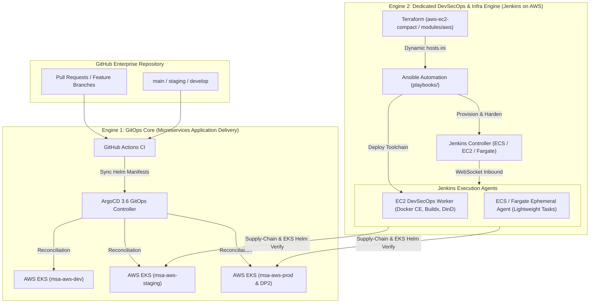

# Jenkins CI/CD & DevSecOps Platform on AWS (EC2 / ECS / Fargate & EKS)

> [!TIP]
> 🧭 **[Enterprise Platform Hub](../../README.md)** > **03. DevSecOps & Testing** > `JENKINS_AWS_EKS_PIPELINE.md`

## 1. Dual-Engine Strategic CI/CD Architecture

The enterprise delivery architecture adopts a complementary **Dual-Engine Model** combining the strengths of GitOps with centralized DevSecOps automation:



### Strategic Division of Responsibilities
1. **GitHub Actions + ArgoCD (GitOps Continuous Delivery)**:
   - Primary continuous integration for developer feature pull requests and automated manifest synchronization.
   - Declarative GitOps reconciliation directly into AWS EKS clusters (`msa-aws-dev`, `msa-aws-staging`, `msa-aws-prod`) using Helm charts managed in `deploy/helm/`.
2. **Jenkins + Terraform + Ansible (Enterprise DevSecOps & Infrastructure Verification)**:
   - Dedicated AWS infrastructure testing, deep security scanning, compliance verification, and isolated multi-environment verification.
   - Runs the comprehensive 14-stage security gate matrix (Gitleaks, Semgrep, Trivy FS/Image, Cosign OCI Signing, Conftest OPA, OWASP ZAP DAST, and k6 Load Testing).
   - Deployed on lightweight AWS compute (EC2 / ECS / Fargate) with automated configuration management via Ansible.

---

## 2. Infrastructure Automation: Terraform & Ansible Provisioning

The Jenkins controller and worker nodes are provisioned using reusable Terraform configurations in `terraform/environments/aws-ec2-compact/` and hardened using Ansible playbooks in `ansible/`.

### A. Environment Sizing & Configuration Matrix

| Environment | Terraform tfvars | Instance Type | vCPU / RAM | EBS Storage (GP3) | Target Role |
| :--- | :--- | :--- | :--- | :--- | :--- |
| **Development** | `dev.example.tfvars` | `t3.xlarge` | 4 vCPU / 16 GB | 50 GiB | Compact dev stack & lightweight builds |
| **Staging** | `staging.example.tfvars` | `t3.2xlarge` | 8 vCPU / 32 GB | 80 GiB | Pre-production DevSecOps & integration tests |
| **Production** | `prod.example.tfvars` | `c6i.4xlarge` | 16 vCPU / 32 GB | 120 GiB | High-throughput concurrent pipeline execution |

### B. Dynamic Inventory Generation
Terraform automatically generates the Ansible inventory (`ansible/inventory/hosts.ini`) upon `terraform apply`, establishing:
```ini
[microservices_hosts]
compact-node ansible_host=<EIP> ansible_user=ubuntu ansible_ssh_private_key_file=~/.ssh/id_rsa

[jenkins_controller]
compact-node ansible_host=<EIP> ansible_user=ubuntu ansible_ssh_private_key_file=~/.ssh/id_rsa

[jenkins_worker]
compact-node ansible_host=<EIP> ansible_user=ubuntu ansible_ssh_private_key_file=~/.ssh/id_rsa

[all:vars]
ansible_python_interpreter=/usr/bin/python3
environment_tier=dev
admin_cidr=203.0.113.10/32
```

### C. Ansible Automation Playbooks
- **Jenkins Controller Playbook** ([`ansible/playbooks/setup-jenkins-controller.yml`](file:///c:/Users/jorge/codegxx/microservices-architecture/ansible/playbooks/setup-jenkins-controller.yml)):
  - Deploys the official `jenkins/jenkins:lts-jdk21` container with persistent storage at `/opt/jenkins-controller/data`.
  - Configures UFW firewall restricting ports `22`, `8080` (Web UI/API), and `50000` to `admin_cidr`.
  - Integrates with systemd as `jenkins-controller.service` for automatic recovery.
  - Automatically retrieves and displays the initial administrator password.
- **Jenkins DevSecOps Worker Playbook** ([`ansible/playbooks/setup-jenkins-worker.yml`](file:///c:/Users/jorge/codegxx/microservices-architecture/ansible/playbooks/setup-jenkins-worker.yml)):
  - Installs Docker CE with `docker-buildx-plugin` for advanced multi-stage caching.
  - Provisions polyglot language runtimes: **OpenJDK 21 + Maven**, **Node.js 22 LTS**, **Python 3.12**, and **Go 1.23.3**.
  - Provisions DevOps and security toolchains: **AWS CLI v2**, **kubectl v1.31**, **Helm 3/4**, **Trivy**, **Cosign**, **Gitleaks**, and **Conftest**.

---

## 3. Compute Models on AWS: EC2 vs. ECS / Fargate

Depending on the operational requirements of each pipeline stage, Jenkins leverages two execution models:

| Dimension | Dedicated EC2 Worker (`linux-docker-devsecops`) | AWS ECS / AWS Fargate Ephemeral Agent |
| :--- | :--- | :--- |
| **Compute Backing** | EC2 instance (`t3.xlarge` / `c6i.4xlarge`) | Serverless container task in ECS cluster |
| **Docker Daemon Access** | Full `/var/run/docker.sock` access + Buildx plugin | No Docker daemon (Rootless / Kaniko / Podman only) |
| **Ideal Workloads** | Container image building, DinD, OWASP ZAP DAST, k6 load testing, heavy matrix tests | Linting, unit tests, static code analysis (Semgrep CLI), Terraform plan validation |
| **Cost Profile** | Continuous or scheduled EC2 hourly cost | Pay-per-second execution during job runtime only |
| **Isolation** | Shared OS filesystem per instance | 100% ephemeral isolation per task |

---

## 4. Modern Agent Connectivity (WebSocket over HTTP/HTTPS)

Modern Jenkins agent architecture **deprecates legacy TCP remoting on port 50000** and the outdated `-jnlpUrl` syntax:

```mermaid
sequenceDiagram
    participant Agent as Jenkins Worker (EC2 / ECS / K8s)
    participant Ingress as AWS ALB / Reverse Proxy (Port 443 / 8080)
    participant Controller as Jenkins Controller

    Note over Agent, Ingress: Modern WebSocket Mode (-webSocket)
    Agent->>Ingress: HTTP GET /login (Upgrade: websocket)
    Ingress->>Controller: HTTP 101 Switching Protocols
    Controller-->>Agent: Bidirectional WebSocket Channel Established
    Note over Agent, Controller: No port 50000 required; works across NAT & ALBs
```

To connect workers without opening extra firewall ports:
```bash
java -jar agent.jar \
  -url http://<JENKINS_HOST>:8080 \
  -name worker-ec2-01 \
  -secret <SECRET_TOKEN> \
  -workDir /home/jenkins/agent \
  -webSocket
```

---

## 5. Branch and environment mapping

| Branch | EKS cluster | Namespace | Production approval |
|---|---|---|---|
| `develop` | No AWS deployment; development remains on Minikube | — | No |
| `staging` | `msa-aws-staging` | `staging` | No |
| `master` | `msa-aws-prod` and `msa-aws-dp2-prod` | `production` | Jenkins `input` gate |

Pull request builds run validation only. Publishing is limited to the immutable Docker Hub tags `1.0.0` and `1.1.0`. The pipeline reuses an existing tag digest, blocks images with fixable critical vulnerabilities, signs newly published image digests with Cosign, and applies the repository's two-tag retention script. Publication is serialized per image repository. A deployment selects the full service matrix, so the umbrella release cannot unintentionally reset images for unselected services. Helm uses `--atomic --wait`; if a later deployment or post-deployment check fails, the pipeline restores the previous Helm revision on every target cluster.

Cloud deployment is disabled by default. `ENABLE_AWS_DEPLOY` and `DEPLOY` must both be selected explicitly. AWS deployment is limited to `staging` and `master`; `develop` is reserved for Minikube. Production approval occurs after image validation, publication, signing, and retention.

---

## 6. Jenkins setup & Credentials

Create a Multibranch Pipeline for this repository and enable branch discovery for `develop`, `staging`, and `master`, plus pull requests. Install the Pipeline Utility Steps, AnsiColor, Workspace Cleanup, and Lockable Resources plugins. Restrict who can approve the production `input` step using Jenkins job permissions and the organization's release-approver policy.

Use a trusted, isolated Linux agent labeled `linux-docker-devsecops`. Prefer an EC2 Jenkins agent instance profile or another short-lived AWS IAM identity. Do not configure long-lived AWS access keys. Grant the role only the required `eks:DescribeCluster` permission and authorize it in each target cluster through an EKS access entry (or the cluster's supported IAM authentication mechanism) mapped to namespace-scoped Kubernetes RBAC.

Configure these Jenkins credentials and environment variables:

| Jenkins credential / variable | Type | Use |
|---|---|---|
| `dockerhub-credentials` | Username with password | Docker Hub push and tag retention API |
| `cosign-private-key` | Secret file | Sign newly published OCI image digests |
| `cosign-password` | Secret text | Unlock the Cosign private key |
| `cosign-public-key` | Secret file | Verify the supply-chain manifest and image signatures before deployment |
| `sonar-token` | Secret text | SonarCloud analysis when `SONAR_ENABLED` is selected |
| `snyk-token` | Secret text | Snyk SCA when `SNYK_ENABLED` is selected |
| `AWS_ACCOUNT_ID` | Jenkins environment variable | Expected AWS account; deployment aborts if STS reports a different account |
| `AWS_REGION` | Jenkins environment variable | Defaults to `us-east-1` in the Jenkinsfile |
| `SONAR_ORGANIZATION` | Jenkins environment variable | SonarCloud organization key |
| `SONAR_HOST_URL` | Optional environment variable | Defaults to `https://sonarcloud.io` |
| `DEVSECOPS_BASE_URL` | Jenkins environment variable | API endpoint for post-deployment checks |
| `DEVSECOPS_FRONTEND_URL` | Jenkins environment variable | Frontend endpoint for smoke and DAST checks |
| `DEVSECOPS_KEYCLOAK_URL` | Jenkins environment variable | Keycloak endpoint for Newman tests |

---

## 7. Running the pipeline

- Run a branch or pull request build with `PUBLISH_VERSION=none` for CI and security checks only.
- Choose `SERVICE_SCOPE=changed` for normal incremental work or `all` for a full platform run.
- For a release, select only `1.0.0` or `1.1.0`. The pipeline rejects pull request publication and deployment requests on non-environment branches.
- To deploy to AWS, select `ENABLE_AWS_DEPLOY=true` and `DEPLOY=true` on `staging` or `master`. The `master` build pauses for human approval before deploying to both production clusters.
- Select `POST_DEPLOY_ENABLED` to run Newman API contracts, storefront smoke checks, k6 load testing, and OWASP ZAP against the deployed release. Those endpoints must be configured in Jenkins first.

---

## 8. DevSecOps Quality Gates Matrix across Environments

| Pipeline Stage | Security Tool | Dev (`develop` / Minikube) | Staging (`staging` / AWS) | Prod (`master` / AWS EKS) |
| :--- | :--- | :--- | :--- | :--- |
| **Secrets Detection** | Gitleaks v8 | Block commit if secrets found | Zero new leaks permitted | Zero tolerance |
| **Static Analysis (SAST)** | Semgrep | Informational / High alerts | Block on Critical CWEs | Zero Critical / High |
| **Software Composition (SCA)** | Trivy FS / Snyk | Scan dependencies | Block on fixable Criticals | Zero fixable CVEs |
| **Container Scanning** | Trivy Image | Build & scan local image | Block on Critical CVEs | Block on Critical / High CVEs |
| **Supply Chain Signing** | Cosign v2.4+ | Optional | Digest signing | Mandatory signature verification |
| **Policy Compliance** | Conftest (OPA) | Validate Helm schemas | Enforce AWS EKS policies | Gatekeeper + OPA strict mode |
| **Dynamic DAST** | OWASP ZAP | Optional local smoke | Baseline scan against staging | Full active scan against pre-prod |
| **Load & Performance** | Grafana k6 | 10 VUs smoke test | 50 VUs p95 < 200ms | 100 VUs SLO verification |
