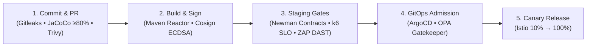

# 🛡️ Pillar 03: DevSecOps, Governance & Quality Assurance

> [!TIP]
> 🧭 **[Enterprise Platform Hub](../../README.md)** > **03. DevSecOps, Governance & Quality Assurance**

---

## 🎯 Domain Overview

The **DevSecOps, Governance & Quality Assurance** pillar formalizes the software supply chain security, automated testing, quality gates, and operating model for the platform. It enforces Shift-Left continuous security verification (Gitleaks, Trivy, OPA Conftest, Cosign), automated testing (Newman API contracts, k6 load testing, OWASP ZAP DAST), and GitOps delivery pipelines.

---

## 📚 Document Index & Recommended Reading Order

| # | Document | Primary Persona | Strategic Scope & Key Takeaways |
| :-: | :--- | :--- | :--- |
| **1** | [**DEVSECOPS_GOVERNANCE_AND_MODEL.md**](./DEVSECOPS_GOVERNANCE_AND_MODEL.md) | SecOps, PMO, Tech Leads | Enterprise DevSecOps operating model: 6 stakeholder personas, evolution from committee gates to automated continuous assurance, and S-SDLC lifecycle. |
| **2** | [**DEVSECOPS_PIPELINES.md**](./DEVSECOPS_PIPELINES.md) | DevOps, CI/CD Engineers | Multi-stage pipeline architecture (GitHub Actions & Azure DevOps), secret scanning, container scanning, and artifact signing. |
| **3** | [**QUALITY_GATES_AND_DOD.md**](./QUALITY_GATES_AND_DOD.md) | Developers, QA Leads | Definition of Ready (DoR), 3-tier Definition of Done (DoD), branch protection, and SonarQube / JaCoCo quality gate thresholds. |
| **4** | [**DYNAMIC_AND_CHAOS_TESTING.md**](./DYNAMIC_AND_CHAOS_TESTING.md) | QA Automation, SREs | k6 performance SLO validation, Resilience4j circuit breaker state verification, rate limiting, and automated chaos injection. |
| **5** | [**GIT_WORKFLOW_AND_COLLABORATION.md**](./GIT_WORKFLOW_AND_COLLABORATION.md) | All Contributors | GitFlow branching model (`master`, `staging`, `develop`, `feature/*`, `hotfix/*`), Conventional Commits specification, and PR governance. |
| **6** | [**BRANCH_ENVIRONMENT_STRATEGY.md**](./BRANCH_ENVIRONMENT_STRATEGY.md) | DevOps, Release Managers | Canonical `develop` $\rightarrow$ `staging` $\rightarrow$ `master` promotion runbook, GitHub Environment approval gates, and paused cloud deployment checklist. |
| **7** | [**DEVSECOPS_MATURITY_ASSESSMENT.md**](./DEVSECOPS_MATURITY_ASSESSMENT.md) | SecOps, Auditors | Multi-cloud DevSecOps and software supply-chain maturity scorecard across CI/CD, IaC, GitOps, runtime security, and BCDR. |
| **8** | [**REMEDIATION_CHANGELOG.md**](./REMEDIATION_CHANGELOG.md) | Architects, Engineering Leads | Chronological `P0`–`P3` remediation log covering Terraform dual-dataplane fixes, GitOps hardening, immutable digest promotion, and Git governance. |

---

## 🧭 Platform Documentation Pillars

* 🏗️ **[Pillar 01: System Architecture & Technical Design](../01-architecture/README.md)**
* 🚀 **[Pillar 02: Platform Operations & Local Deployment](../02-operations/README.md)**
* 🛡️ **Pillar 03:** DevSecOps, Governance & Quality Assurance (You are here)
* 📊 **[Pillar 04: Observability & Telemetry](../04-observability/README.md)**
