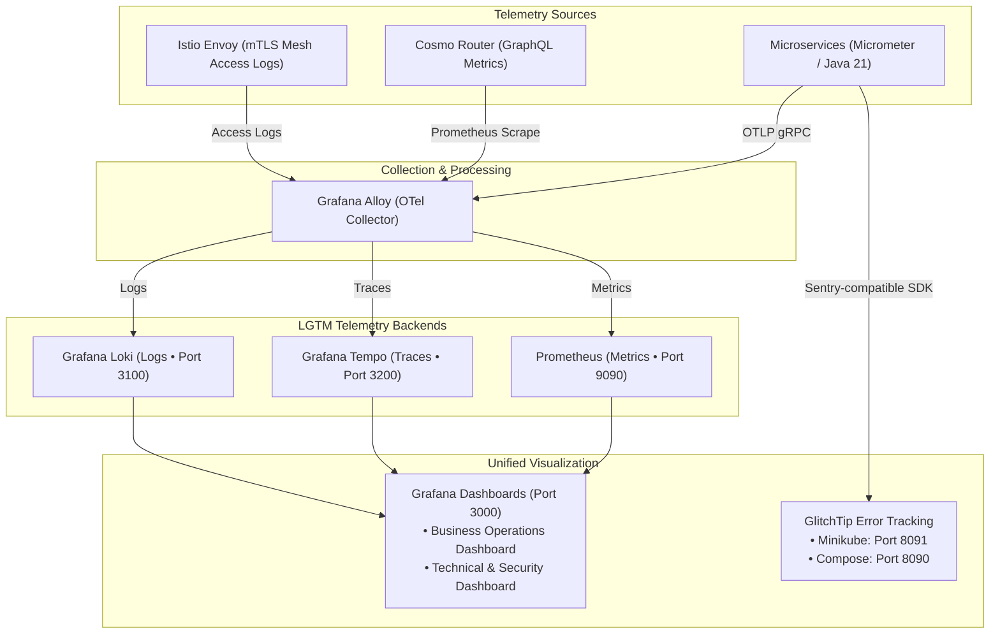

# 📊 Pillar 04: Observability & Telemetry

> [!TIP]
> 🧭 **[Enterprise Platform Hub](../../README.md)** > **04. Observability & Telemetry**

---

## 🎯 Domain Overview

The **Observability & Telemetry** pillar provides full-stack visibility across the microservices ecosystem using the **LGTM Stack** (Loki, Grafana, Tempo, Mimir/Prometheus) unified through **Grafana Alloy** and the **OpenTelemetry (OTel)** standard. It enables three-dimensional correlation: linking metrics anomalies to distributed trace spans and granular application logs. **GlitchTip** complements this stack with grouped application errors and release tracking; it is a separate dashboard, not a Grafana datasource.

For Minikube, open `http://localhost:8091` after the local tunnel supervisor is running. `.\platform-minikube.ps1 urls` lists GlitchTip with the other dashboards, and `.\platform-minikube.ps1 diagnose -Action components -Target glitchtip` checks its dashboard tunnel. Compose uses `http://localhost:8090` by default. Each deployment has its own database and admin credentials; set the same email and password in both environments if you want the same login.

---

## 📚 Document Index & Recommended Reading Order

| # | Document | Primary Persona | Strategic Scope & Key Takeaways |
| :-: | :--- | :--- | :--- |
| **1** | [**OBSERVABILITY_QUERIES.md**](./OBSERVABILITY_QUERIES.md) | SREs, DevOps, Developers | Comprehensive query handbook: PromQL (throughput, error rates, JVM heap, HikariCP), LogQL (structured JSON, log levels), TraceQL (distributed traces), and alert definitions. |

---

## 🧭 Platform Documentation Pillars

* 🏗️ **[Pillar 01: System Architecture & Technical Design](../01-architecture/README.md)**
* 🚀 **[Pillar 02: Platform Operations & Local Deployment](../02-operations/README.md)**
* 🛡️ **[Pillar 03: DevSecOps, Governance & Quality Assurance](../03-devsecops-and-testing/README.md)**
* 📊 **Pillar 04:** Observability & Telemetry (You are here)
