# Architecture Blueprint: Local-First Open-Source AI Application Architecture (Integrated)

This document specifies the end-to-end architecture for **AuraCommerce AI**, an enterprise-grade, 100% open-source, local-first multi-agent AI system integrated into **Enterprise Microservices Architecture**.

---

## 1. High-Level Architecture Diagram

```mermaid
flowchart TB
    subgraph Frontend_Layer["1. Unified Frontend Layer (React 19 • Port 5173)"]
        StoreUI["Storefront Catalog & Checkout"]
        AICopilotDrawer["Floating AI Copilot Drawer (LangGraph UI)"]
        HITL_UI["Human-in-the-Loop Supervisor Panel"]
    end

    subgraph API_Gateway["Gateway Layer"]
        CosmoRouter["Cosmo Router GraphQL Gateway (:8080)"]
        FastAPI_AI["AI Copilot Service Gateway (:8010)"]
    end

    subgraph Orchestration_Layer["2. Agent Orchestration (LangGraph & LangChain)"]
        Supervisor["Supervisor / Intent Router Node"]
        ProductAdvisor["Product Recommendation Agent"]
        OrderSupport["Order & Support Agent"]
        PolicyFAQ["Policy & FAQ RAG Agent"]
        HITL_Gate{"HITL Approval Node (Interrupt > $50)"}
        StateCheckpointer["LangGraph State Checkpointer (Redis :6379)"]
    end

    subgraph Knowledge_Layer["3. Knowledge Layer (RAG)"]
        VectorDB[("ChromaDB / Local Hybrid Retriever")]
        Embeddings["Local Embeddings (all-MiniLM-L6-v2)"]
        CatalogRetriever["Hybrid Catalog & Policy Retriever"]
    end

    subgraph Models_Layer["4. Models Layer (Local LLMs)"]
        OllamaServer["Ollama Local Inference (:11434)"]
        LlamaModel["Llama-3.1-8B (Auto-Downloaded by Init Sidecar)"]
    end

    subgraph Tools_Layer["5. Tools Layer (Model Context Protocol - MCP)"]
        MCPServer["eCommerce MCP Server Engine"]
        OrdersTool["Tool: get_order_details(order_id)"]
        InventoryTool["Tool: check_inventory(sku)"]
        RefundTool["Tool: request_refund(order_id, amount)"]
        ShippingTool["Tool: calculate_shipping(zip, weight)"]
    end

    subgraph Microservices_Layer["6. Core Spring Boot Microservices"]
        OrdService["Orders Service (:8003 • DHL Tracking)"]
        ProdService["Products Service (:8004 • Catalog)"]
        InvService["Inventory Service (:8001 • Stock)"]
    end

    subgraph Observability_Layer["7. Observability & Evals Layer"]
        Phoenix["Arize Phoenix (:6006 • Prompts, Latency, Tokens)"]
        LGTM["Grafana LGTM Stack (:3000 • Traces, Logs, Metrics)"]
        EvalEngine["Automated Golden Dataset Evals"]
    end

    subgraph Infra_Layer["8. Deployment & Infrastructure Layer"]
        Compose["Docker Compose (compose.yaml • Network: spring)"]
        RedisPlatform["Platform Redis 8.8.1 (:6379)"]
    end

    %% Connections
    StoreUI <--> CosmoRouter
    AICopilotDrawer <--> FastAPI_AI
    FastAPI_AI --> Supervisor
    Supervisor --> ProductAdvisor
    Supervisor --> OrderSupport
    Supervisor --> PolicyFAQ
    OrderSupport --> HITL_Gate
    HITL_Gate -.->|Approval Required| HITL_UI

    Supervisor <--> StateCheckpointer
    StateCheckpointer --> RedisPlatform

    ProductAdvisor <--> CatalogRetriever
    CatalogRetriever --> VectorDB

    Supervisor --> OllamaServer
    OllamaServer --> LlamaModel

    OrderSupport <--> MCPServer
    MCPServer --> OrdersTool
    MCPServer --> InventoryTool
    MCPServer --> RefundTool
    MCPServer --> ShippingTool

    OrdersTool --> OrdService
    InventoryTool --> InvService
    ProductAdvisor --> ProdService

    Supervisor -.-> Phoenix
    EvalEngine -.-> Phoenix
```

---

## 2. Integration Highlights

1. **Unified Front Door**: One single React 19 SPA running on port 5173. The AI Copilot is embedded seamlessly as an expandable drawer (`<AICopilot />`).
2. **Zero Port Collisions**:
   - Grafana remains on `3000`.
   - Microservices stay on `8001`-`8005`.
   - Cosmo Router on `8080`.
   - Keycloak on `8181`.
   - AI Copilot Service on `8010`.
   - Arize Phoenix on `6006`.
   - Ollama on `11434`.
3. **Shared Infrastructure**: The AI service connects directly to the platform's Redis 8.8.1 (`redis:6379`) on the `spring` network.
4. **Live MCP Integration**: Orders, inventory, and refunds invoke the actual Spring Boot microservices while maintaining local mock fallbacks for isolated offline development.
